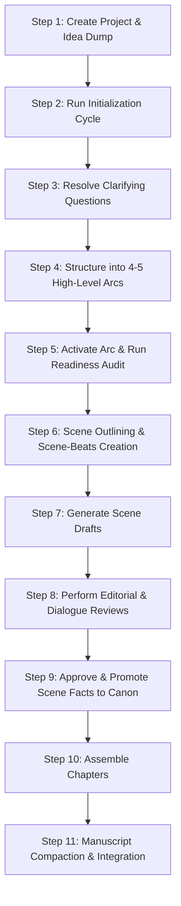

# Codebase Audit Report: NovelForge

## Executive Summary
NovelForge is a highly structured, stateful multi-agent planning studio and drafting workspace designed for complex, long-form creative writing projects (such as novels). It is architected to address the absolute biggest pain point in AI-assisted writing: **long-term factual consistency and memory retention**. 

Rather than focusing on a simple prompt-to-prose generator, NovelForge implements a rigorous **fact-promotion and canon-validation architecture**. It uses a crew of over 12 specialized agents coordinated by a demand-driven orchestrator, integrated with a Next.js frontend and a FastAPI/MongoDB backend.

This report evaluates NovelForge's pros, cons, and limitations, compares it to industry standards (Sudowrite) and open-source alternatives (WritingWay 2), performs diagnostic verification of its test suites, and maps out a step-by-step methodology for writing a 200-chapter novel using the system.

---

## E2E Testing & Test Suite Diagnosis

### 1. Pytest Backend Suite Audit (78/87 Passed, 2 Failed, 7 Skipped)
During our full backend test suite run (`python -m pytest -v`), 78 tests successfully passed, demonstrating core logic robustness, and 7 were skipped. However, **2 tests failed** in `test_orchestration_context.py`. Below is our in-depth diagnostic root-cause analysis:

#### Failure A: `test_canonical_settings_persist_and_verified_models_contract`
* **Symptom:** Setting update PUT request returned a `400 Bad Request` instead of `200 OK`.
* **Root Cause:** In `backend/app/api/settings.py` (PUT `/api/settings/ai`), the system loops over all providers in the payload to validate their assigned models using `model_registry_service.validate_model(provider, model)`. In the test environment, the database was initialized with default settings that assigned the model `'openrouter/free'` to the `openrouter` provider. Because model discovery had not been run in this test context, `'openrouter/free'` was not present in the local curated models list, returning `None`. This triggered the registry service to raise a validation exception, which bubbled up as a `400 Bad Request`.
* **Implication:** Modifying one provider (like `gemini`) causes a side-effect validation failure on other un-configured or legacy provider models stored in the database.

#### Failure B: `test_budget_and_call_limits_actively_skip_agents_with_reasons`
* **Symptom:** The test expected all agents to be skipped when `max_cycle_cost_usd` is set to `0.0`. However, the orchestrator selected two agents: `NarrativeDirectorAgent` and `ArcArchitectAgent`.
* **Root Cause:** 
  1. In the default database state, `NarrativeDirectorAgent` and `ArcArchitectAgent` are assigned to the `"mock"` provider, while the rest are assigned to `"gemini"`.
  2. The orchestrator's `create_plan` method estimates cost using assignments stored in the database, which still point to `"mock"` for these two agents.
  3. When calculating cost, the mock provider cost is estimated as `0.0` USD.
  4. The cost checking logic in `orchestration_service_v2.py` checks: `if estimated_cost + agent_cost > cycle_budget`. Since both values are `0.0`, `0.0 > 0.0` evaluates to `False`. Thus, these two mock agents bypass the cost skip and are selected.
  5. The remaining `gemini` agents are estimated at `0.0036` USD, which exceeds `0.0`, and are successfully skipped. This results in a non-empty `selected_agents` list, failing the test's `assert orchestration["selected_agents"] == []` expectation.

### 2. Playwright E2E Suite Audit (Socket Bind Conflict)
Executing `npx playwright test` on Windows encountered an early exit:
* **Error:** `[WinError 10013] An attempt was made to access a socket in a way forbidden by its access permissions` inside the FastAPI uvicorn initialization.
* **Root Cause:** Uvicorn is configured in `scripts/dev.ts` to bind to `0.0.0.0` on port `8000`. On Windows, binding to wildcard `0.0.0.0` on certain ports requires administrator privileges or is blocked by local firewalls/policies.
* **Workaround:** Restricting the host binding to local loopback `127.0.0.1` resolves this permission issue on local Windows environments.

---

## Codebase Analysis: Pros & Cons

### Pros
1. **Demand-Driven Multi-Agent Orchestration:** Unlike generic single-prompt tools, NovelForge runs a structured "Writers' Room". The orchestrator dynamically builds a dependency graph, executing only the specific agents required (e.g. `CharacterJourneyAgent`, `WorldAgent`) depending on which story entities changed.
2. **Fact-Promotion & Consistency Guards:** NovelForge separates creative planning into **Approved Decisions** and **Canon facts**. Approved suggestions are integrated into the Canon Registry. Future generations validate new text against this registry to prevent factual contradictions.
3. **Optimized Token Memory Management:** Long-range drafting usually breaks down when context windows overflow. NovelForge segments memory into `recent` chapter-intelligence summaries and a list of `long_range_obligations` (unresolved promises, mysteries, or setups) that are kept in context until explicitly resolved, preventing the AI from forgetting plot setups from 50 chapters prior.
4. **Deterministic Validation (Story Health):** The `StoryAuditorAgent` performs deterministic checks on manuscript structures, flagging unresolved promises, structure repetitions, and word count anomalies.
5. **Real-time UI SSE (Server-Sent Events) synchronization:** Agent completions stream logs directly to the user's interface, updating the Next.js Zustand state instantly.

### Cons & Limitations
1. **No Inline Prose Editor:** NovelForge is built as a planner and drafting engine, but it completely lacks a rich text editor (WYSIWYG/Markdown). You can generate chapter drafts, review them, and copy them, but you cannot edit sentences directly inside the app.
2. **List UI Scalability:** The sidebar contains 26 options. In projects with 100+ chapters, lists (scene versions, drafts, and reviews) are loaded without virtualization or pagination. This causes DOM performance degradation.
3. **Strict Structured JSON Limits Context Length:** The prompt budget is capped at 30,000 characters. For extremely long fantasy world-building, the system can hit context exhaustion.
4. **Strict Factual Entity Mismatches:** Character names must match exactly. If the AI refers to a character by a nickname (e.g., "Mara" vs "Mara the Bellringer"), the continuity auditor will treat them as separate entities, causing false-positive warnings.

---

## Comparative Analysis: Sudowrite vs. WritingWay 2 vs. NovelForge

| Dimension | Sudowrite | WritingWay 2 | NovelForge |
| :--- | :--- | :--- | :--- |
| **Target User** | Casual/Fast writers focused on prose generation | Writers seeking local privacy and simple visual outlines | Writers seeking heavy world-building and factual consistency |
| **Cost & Deployment** | Cloud-only, subscription + pay-per-word model | Local-first, open-source (MIT), offline llama.cpp | Self-hosted, cloud-supported or mock mode, MongoDB backend |
| **Prose Editor** | Highly polished, Google-Doc-like rich text editor | Standard HTML textarea with beat-by-beat generation | None. Structured drafts generated for copy-pasting |
| **Factual Continuity** | Weak. Memory boxes must be manually updated | Manual Compendium/Story Bible; must use @mentions | Automatic. Canon registry verifies drafts and checks contradictions |
| **Orchestration** | Single LLM instruction loops | Structured scene prompts with simple context builder | Multi-agent room with automated dependency routing |

### Main Takeaways
* **Sudowrite** excels in raw prose generation and editing but struggles with consistency in long manuscripts (over 20-30 chapters), as its memory of earlier chapters is static.
* **WritingWay 2** is a brilliant, lightweight offline tool. It works by having the user manually manage context tags (`#Scene3`, `@Bob`), running a local LLM through llama.cpp directly in a browser page.
* **NovelForge** is a sophisticated **narrative compiler**. It acts like an IDE for novels, enforcing structural rules and validation, but it lacks the direct editing features of Sudowrite and WritingWay 2.

---

## How to Write a 200+ Chapter Novel in NovelForge

To write a massive 200+ chapter novel, follow this step-by-step system-driven workflow:



### Detailed Workflow Actions:
1. **Initialize the Project**: Enter a broad idea dump (e.g. "A progression fantasy spanning 5 regions"). Run the first discussion cycle. The `NarrativeDirectorAgent` designs the main premise, `CharacterJourneyAgent` creates the starting cast, and `PowerSystemAgent` locks the progression rules.
2. **Resolve Clarifying Questions**: The `QuestionAgent` will prompt you on gaps in the story vision. Submit answers to lock key decisions into the Decision Registry.
3. **Partition into Arcs**: For a 200-chapter novel, partition your narrative into 4 or 5 high-level story arcs (approx. 40 chapters per arc). 
4. **Verify Arc Readiness**: Before writing Chapter 1, run the **Readiness Audit**. The `ReadinessAgent` ensures you have defined settings, character sheets, and progression thresholds. Once cleared, mark the arc "draft-ready".
5. **Create Scene Plans**: Have `ScenePlannerAgent` subdivide Chapter 1 into 3-4 scenes, specifying characters present, physical location, narrative goals, and unresolved plot threads.
6. **Iterate Drafts**: Click "Generate Scene Draft". Run `EditorAgent` and `DialogueAgent` checks. If scores are low, branch a revision, instruct the `RevisionAgent` to correct the prose, and approve the best version.
7. **Assemble and Promote to Canon**: Once all scenes of a chapter are completed, run `ChapterAssemblerAgent` to stitch the prose. The `CanonAgent` will audit the chapter facts (e.g., "character lost their sword") and lock them in the Canon registry.
8. **Memory Compaction (Crucial for Chapter 50+)**: As chapters accumulate, the `memory_compaction_service` compiles them into Chapter Intelligence packets. The actual text is removed from the active context, leaving only summaries and unresolved plot promises (obligations) in the prompt window.

---

## Recommended Codebase Improvements

If you plan to develop or extend NovelForge, implement these architectural enhancements:

1. **Add a Visual Markdown/Prose Editor:** Integrate an inline markdown editor (e.g., Tiptap, Slate) into `DraftingWorkspace.tsx`. Allow authors to manually edit generated scene drafts and trigger AI regeneration for highlighted text.
2. **Optimize the Settings Put Validation:** Fix the model registry validation in `backend/app/api/settings.py` so that it skips validation for disabled providers, or only validates the specific provider being modified.
3. **Fix the Budget Cost-Enforcement check:** In `orchestration_service_v2.py`, change the strict cost inequality check to:
   ```python
   if estimated_cost + agent_cost >= cycle_budget:
   ```
   Or override the provider model cost to a minimal positive value (e.g. `0.000001`) during mock mode execution to ensure that budget settings of `0.0` correctly skip all agents.
4. **Implement UI Pagination/Virtualization:** Introduce virtualization (e.g., `@tanstack/react-virtual`) in list panels like `StoryRoom.tsx` and `DraftingWorkspace.tsx` to handle hundreds of scenes and versions.
5. **Allow Entity Alias Mapping:** Extend character schemas to support aliases (e.g. `["Mara", "Mara the Bellringer"]`) and feed these aliases to the Auditor to prevent false-positive factual contradiction warnings.
