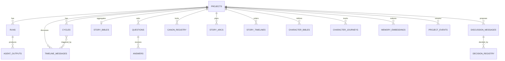

# NovelForge Database Model Audit

Audit date: 2026-06-13

Database: MongoDB `novelforge` on the configured local instance.

This audit combines source-level collection usage with a live database
inspection. Counts are a point-in-time measurement and will change.

## Executive Result

Status: **FAIL**

The database is flexible enough to support the existing prototype, but it is not
production-safe for long-running projects.

Key results:

- 54 live collections.
- 786 projects.
- 158 Story Bible records.
- 11,486 memory embedding records.
- Only five non-`_id` indexes in the entire database.
- 628 projects have no Story Bible.
- 350 projects have no Story Bible, run, or cycle.
- 177 duplicate `story_timelines` identity groups containing 371 excess rows.
- 60 duplicate `mystery_registry` identity groups.
- Orphan project references remain in six project-scoped collections.
- Several core collections contain two incompatible schema generations.
- There are no schema validators, migrations for narrative collections, TTL
  policies, or transactional write boundaries.

## Physical Model

MongoDB references use `ObjectId` fields, primarily `project_id`. Relationships
are application-enforced. There are no foreign keys.

## Live Collection Inventory

### Project And Workflow

| Collection | Count | Intended role | Audit |
| --- | ---: | --- | --- |
| `projects` | 786 | Project shell and initial story inputs | 5 records lack status; 628 lack Story Bible |
| `runs` | 367 | Workflow execution state | No project/time/status index |
| `cycles` | 358 | Discussion/planning cycle state | No unique project/cycle index |
| `agent_outputs` | 2,712 | Per-agent run output | Legacy and studio schemas coexist |
| `timeline_messages` | 4,635 | User/agent room timeline | 3 orphan project refs; unbounded |
| `questions` | 459 | User questions and answers | Legacy rows lack cycle/agent metadata |
| `answers` | 27 | Separate answer history | Duplicates answer stored on question |
| `outlines` | 269 | Retired whole-novel outline | Legacy architecture |
| `characters` | 0 | Retired typed characters | Empty compatibility collection |

### Narrative Artifacts

| Collection | Count | Intended role | Audit |
| --- | ---: | --- | --- |
| `story_bibles` | 158 | Materialized project aggregate | No unique project index or schema version |
| `story_visions` | 135 | Current vision | Old/new metadata variants |
| `character_bibles` | 825 | Character records | Two schemas; relationship type drift |
| `character_journeys` | 198 | Character journey | `future_plans` and relationships type drift |
| `world_bibles` | 224 | World model | Legacy and studio fields coexist |
| `power_systems` | 132 | Power system | `concept_tree` array/object drift |
| `factions` | 140 | Factions | No uniqueness index |
| `relationship_graphs` | 316 | Character relationship edges | No canonical edge direction rule |
| `plot_threads` | 383 | Open/resolved threads | Exact title is identity |
| `theme_registry` | 315 | Project theme record | More rows than projects with active studio data |
| `foreshadow_registry` | 247 | Foreshadow records | Not written by active studio agents |
| `mystery_registry` | 195 | Mystery records | 60 duplicate logical groups |
| `story_arcs` | 255 | Arc plans | Two schemas; no approval lifecycle |
| `story_timelines` | 629 | In-world timeline | Two schemas; 371 excess duplicates |
| `scene_registry` | 382 | Scene plans | Legacy and new metadata variants |
| `scene_drafts` | 58 | Historical prose drafts | No active writer currently creates these |
| `ai_insights` | 135 | Director and pacing analysis | Single mutable document per project by convention |
| `continuity_reports` | 251 | Continuity findings | Not written by current studio cycle |
| `contradiction_reports` | 64 | Canon contradiction candidates | Open reports have no resolution endpoint |

### Collaboration And Governance

| Collection | Count | Intended role | Audit |
| --- | ---: | --- | --- |
| `discussion_messages` | 1,569 | User messages and agent proposals | Proposal and approved artifact are not separated |
| `discussion_threads` | 3 | Proposal discussion | Embedded messages, no message-level identity |
| `decision_registry` | 130 | User/proposal decisions | Three source-specific document shapes |
| `canon_registry` | 103 | Locked facts | Bag-of-words fingerprint identity |
| `cycle_tasks` | 6 | Deferred discussion/expansion work | Does not constrain next cycle agent selection |
| `audit_logs` | 26 | Discussion action audit | No actor/session identity |
| `story_vision_versions` | 0 live collection | Story Vision history | Created lazily; no global version model |

### Memory, Context, And Orchestration

| Collection | Count | Intended role | Audit |
| --- | ---: | --- | --- |
| `memory_embeddings` | 11,486 | Retrieval index | Stale versions accumulate; no unique index |
| `context_packets` | 1,809 | Agent input snapshots | 2 orphan project refs; unbounded large documents |
| `compressed_memories` | 0 live collection | Coarse memory summaries | Active path never creates it |
| `orchestration_runs` | 298 | Routing/execution summary | Two producer schemas; 2 orphan refs |
| `cognition_events` | 978 | Agent cognition log | 2 orphan refs; mostly old/unused path |
| `observability_events` | 222 | Routing observations | 2 orphan refs; unused active path |
| `cycle_costs` | 222 | Cycle token/cost totals | 2 orphan refs; active path does not write it |
| `project_events` | 1,425 | SSE event log | No query index or TTL |
| `execution_traces` | 2,540 | Provider call trace | Global; no project/run/cycle fields |

### Settings, Provider Discovery, And Validation

| Collection | Count | Intended role | Audit |
| --- | ---: | --- | --- |
| `app_settings` | 1 | Canonical global settings | Contains plaintext API keys |
| `api_settings` | 0 live collection | Legacy provider settings | Read for migration only |
| `ai_execution_settings` | 1 | Legacy execution settings | Retained beside canonical settings |
| `agent_model_assignments` | 16 | Legacy assignments | Retained beside canonical settings |
| `provider_models` | 358 | Discovered model catalog | Indexed |
| `provider_status` | 2 | Discovery status | Indexed |
| `provider_model_health` | 359 | Per-model inference health | Indexed |
| `provider_health` | 3 | Runtime provider health | No provider uniqueness index |
| `provider_quota_usage` | 17 | Daily request/token totals | No unique provider/day index |
| `provider_model_cache` | 7 | Retired model cache | No current source owner found |
| `provider_model_validation` | 19 | Retired validation records | No current source owner found |

### Testing And Audit

| Collection | Count | Intended role | Audit |
| --- | ---: | --- | --- |
| `production_audits` | 7 | Project audit results | Four pass, three fail; audit coverage is incomplete |
| `e2e_test_results` | 2 | E2E result persistence | Test data stored in production database |

## Index Audit

MongoDB automatically provides `_id_` on every collection. The only additional
indexes are:

| Collection | Index | Unique |
| --- | --- | --- |
| `provider_models` | `{provider: 1, model_id: 1}` | Yes |
| `provider_models` | `{provider: 1, discovered_at: -1}` | No |
| `provider_status` | `{provider: 1}` | Yes |
| `provider_model_health` | `{provider: 1, model: 1}` | Yes |
| `provider_model_health` | `{provider: 1, success: -1, latency: 1}` | No |

All narrative, workflow, memory, event, discussion, and project queries rely on
collection scans.

### Required Core Indexes

The following are minimum production indexes, not the complete V2 design:

| Collection | Required index |
| --- | --- |
| `projects` | `{updated_at: -1}`, `{status: 1, updated_at: -1}` |
| `runs` | `{project_id: 1, started_at: -1}`, `{project_id: 1, status: 1}` |
| `cycles` | unique `{project_id: 1, cycle_number: 1}` |
| `agent_outputs` | `{project_id: 1, created_at: 1}`, `{run_id: 1, created_at: 1}` |
| `questions` | `{project_id: 1, answered: 1, created_at: 1}` |
| `timeline_messages` | `{project_id: 1, created_at: 1}` |
| `discussion_messages` | `{project_id: 1, cycle_number: -1, created_at: -1}` |
| `decision_registry` | `{project_id: 1, updated_at: -1}` plus source uniqueness |
| `canon_registry` | unique `{project_id: 1, fingerprint: 1}` |
| `story_bibles` | unique `{project_id: 1}` |
| singleton artifacts | unique `{project_id: 1}` |
| named artifacts | unique project/name-or-title compound indexes |
| `story_timelines` | stable entry ID and `{project_id: 1, sort_key: 1}` |
| `memory_embeddings` | unique source/version identity and `{project_id: 1, source_type: 1}` |
| `project_events` | `{project_id: 1, _id: 1}` and TTL/retention strategy |
| `execution_traces` | `{project_id: 1, created_at: -1}`, `{run_id: 1}` |
| `provider_health` | unique `{provider: 1}` |
| `provider_quota_usage` | unique `{provider: 1, day: 1}` |

Unique indexes require cleanup/migration before creation.

## Relationship Audit

### Verified References

The following live references were checked and had no broken targets:

- `agent_outputs.run_id -> runs._id`
- `answers.question_id -> questions._id`
- `decision_registry.question_id -> questions._id`
- `decision_registry.message_id -> discussion_messages._id`
- `audit_logs.proposal_id -> discussion_messages._id`
- `audit_logs.decision_id -> decision_registry._id`
- `discussion_threads.proposal_id -> discussion_messages._id`
- `cycle_tasks.parent_proposal_id -> discussion_messages._id`
- `cycles.trigger_message_ids[] -> timeline_messages._id`

### Orphan Project References

| Collection | Orphan rows |
| --- | ---: |
| `cognition_events` | 2 |
| `context_packets` | 2 |
| `cycle_costs` | 2 |
| `observability_events` | 2 |
| `orchestration_runs` | 2 |
| `timeline_messages` | 3 |

These rows reference deleted/nonexistent projects.

### Missing Aggregate Coverage

| Measure | Count |
| --- | ---: |
| Projects | 786 |
| Projects with Story Bible | 158 |
| Projects without Story Bible | 628 |
| Projects with runs | 355 |
| Projects with cycles | 346 |
| Empty project shells | 350 |

The current project audit reports a missing Story Bible only when explicitly run
for one project. There is no global orphan/coverage audit.

## Duplicate Data Audit

Logical uniqueness was tested using the same keys assumed by the application.

| Collection | Duplicate groups | Excess rows | Largest group |
| --- | ---: | ---: | ---: |
| `mystery_registry` by project/question | 60 | 60 | 2 |
| `story_timelines` by project/event | 177 | 371 | 7 |

The timeline result is partly caused by schema drift: 548 records do not use the
new `event` identity field and therefore collapse into null-key groups during
logical duplicate analysis.

## Schema Inconsistencies

### Story Timeline

Two incompatible shapes coexist:

Legacy-heavy shape:

- `event_title`
- `summary`
- `related_characters`
- `cycle_number`
- optional `arc_title`
- optional `estimated_chapters`

Current studio shape:

- `event`
- `date`
- `age`
- `event_type`
- `participants`
- `consequences`
- `dependencies`
- `arc`

The UI contains fallback logic for both. The current database has 548 records
with `event_title` and only 81 with `event`.

### Story Arcs

Legacy rows use `character_changes` and `ai_notes`. New rows use
`character_growth` and `completion_status`. Neither shape contains the full V2
arc contract, approval state, chapter range, progression links, or stable arc
identity.

### Character Records

Most `character_bibles` use the legacy `aliases/flaws/arc_start/arc_end` shape.
A smaller set uses `age/description/personality/power/arc/current_status`.
`relationships` is an array in most rows and an object in six rows.

`character_journeys.future_plans` is an array in 192 rows and a string in six.
Relationships are also split between array and object.

### World Records

Legacy fields include:

- `setting`
- `rules`
- `lore`
- `magic_systems`
- `religions`
- `historical_events`

Studio fields include:

- `world_rules`
- `locations`
- `races`
- `history`
- `religion`
- `politics`
- `technology`
- `economy`
- `academies`
- `current_conflicts`

Several structured fields alternate between arrays and objects.

### Power System

`concept_tree` is an array in most current rows and an object in six rows.
There is no typed progression graph or character/arc linkage.

### Questions

Only 74 of 459 questions have current `cycle_number`, `agent_name`,
`default_recommendation`, and `story_area` fields. The remainder are legacy.

### Agent Outputs And Context

Studio outputs contain `summary` and `structured_output`; older outputs contain
only serialized `content`. Context packets are produced by both the unused
`ContextEngine` and the active studio's hand-built packet, so packet semantics
are not uniform.

## Duplication And Authority Problems

- Question answers are stored both on `questions` and in `answers`.
- Approved question/proposal content is repeated in `decision_registry`,
  `canon_registry`, discussion messages, Story Bible, and memory embeddings.
- Provider/model/token metadata is copied into every artifact and output.
- Story Bible duplicates almost every project artifact.
- Discussion proposals embed full structured output after artifacts have already
  been persisted separately.
- `timeline_messages` and `discussion_messages` duplicate user interventions.
- Story Vision fields are copied into both `projects` and `story_visions`.
- Three settings generations remain.

Duplication is not inherently wrong for read models, but authority and update
rules are not explicit. This creates stale and contradictory copies.

## Memory Growth Audit

`memory_embeddings` is the largest specialized collection at 11,486 rows.

The active index key is:

`project_id + source_type + source_id + content_hash`

When a source document changes, `content_hash` changes, so the previous memory
row remains. Retrieval does not filter to the latest source version. Reindexing
the whole project after every agent multiplies this problem.

Required corrections:

- stable source identity;
- explicit source version;
- one active embedding per source version policy;
- stale/tombstoned flag or deletion;
- retention and compression policy;
- indexes;
- memory provenance and approval status;
- separate episodic, semantic, canon, and unresolved-question memory.

## Audit Service Gaps

`database_audit_service.py` checks 27 collections, while 54 live collections
exist. It does not globally inspect:

- orphaned `project_id` references;
- most cross-collection references;
- required indexes;
- schema versions;
- mixed field types;
- stale embeddings;
- duplicate Story Bibles;
- parallel run/cycle collisions;
- unresolved contradiction age;
- event/context/trace retention;
- settings generations;
- plaintext secrets.

Its duplicate keys are application checks, not enforced database constraints.

## Deletion And Retention

Project deletion manually calls `delete_many` collection by collection.

Risks:

- no transaction;
- process failure can leave partial deletion;
- newly added collections can be forgotten;
- existing orphan rows prove historical cascade gaps;
- execution traces cannot be deleted by project because they have no project ID;
- no TTL exists for events, context packets, traces, audits, or test records.

V2 should use a collection ownership registry and either transactional deletion
or a durable deletion job with resumable progress.

## V2 Canonical Data Boundaries

The target model should distinguish:

1. **Project input**: user-owned premise and preferences.
2. **Proposal**: generated, editable, not authoritative.
3. **Approved artifact version**: typed and immutable/versioned.
4. **Canon fact**: approved constraint with provenance.
5. **Decision**: human/system decision and rationale.
6. **Read model**: derived Story Bible projection.
7. **Memory**: bounded context records derived from authoritative sources.
8. **Execution**: plan, tasks, attempts, traces, rate-limit events.

Recommended new/normalized collections:

- `story_readiness`
- `artifact_versions`
- `orchestration_plans`
- `orchestration_tasks`
- `story_arcs` with stable IDs and approval state
- `timeline_entries` with lifecycle and uncertainty
- `character_progressions`
- normalized `foreshadow_registry`
- `knowledge_entries`
- `artifact_registry`
- `agent_memories`
- `memory_compaction_runs`
- `provider_rate_limit_events`

The Story Bible should be derived from approved versions plus clearly labeled
proposals, not used as the primary write authority.

## Database Audit Exit Criteria

Database work is not complete until:

- all narrative collections have schema versions and migrations;
- duplicate and orphan findings are resolved;
- required indexes are created and verified;
- project ownership is enforced in every query;
- secrets are removed from plaintext application documents;
- active/stale memory versions are controlled;
- approval and artifact authority are separated;
- global audit coverage includes every owned collection;
- retention policies exist for events, contexts, traces, and test data.
