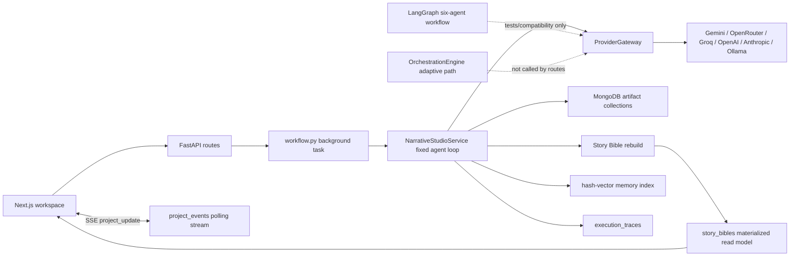

# NovelForge Narrative Studio Production Architecture Audit

Audit date: 2026-06-13

Audit scope: current source tree, current MongoDB database, API route registry,
frontend state and navigation, existing tests, and production build behavior.

Audit constraint: Phase 0 only. No Narrative Studio V2 implementation was
performed during this audit.

## Executive Result

Status: **FAIL - architecture is not ready for the requested V2 evolution**

The current product has a useful Narrative Studio shell, durable MongoDB
artifacts, a Story Bible read model, a discussion room, provider abstraction,
execution traces, and SSE-triggered synchronization. Those are good foundations.

The central production claim is nevertheless incorrect: normal story cycles are
not dynamically orchestrated. Every `/run` and `/cycle` executes the same 12
non-drafting agents in the fixed order declared by `AGENT_SPECS`. The separate
`OrchestrationEngine.run_cycle_observability()` contains selection and budget
logic, but no production route invokes it. It is an unused alternate execution
path.

The highest-risk findings are:

1. Provider API keys are stored in plaintext and returned by the settings API.
2. There is no authentication or project authorization.
3. Child-resource routes do not consistently enforce project ownership.
4. Agent-produced artifacts are persisted before human approval; rejection does
   not roll them back.
5. Agent enable/disable settings, cycle budgets, call caps, and dynamic routing
   are ignored by the active execution path.
6. There is no provider request limiter. Existing delay settings are not used by
   `ProviderGateway`.
7. MongoDB has almost no indexes for production workloads.
8. Memory indexing accumulates stale versions and compaction neither compresses
   active execution context nor deletes redundant detail.
9. The live database contains multiple incompatible schema generations.
10. The readiness, knowledge, artifact, progression, narrative variance, and
    approval-gated arc systems requested for V2 do not exist.

## Audit Method

- Enumerated all 308 source/configuration/test files outside generated folders.
- Imported the FastAPI application and inspected its registered routes.
- Read all backend route, orchestration, memory, persistence, provider, canon,
  Story Bible, agent, model, and database modules.
- Read all frontend routes, Zustand stores, API clients, workflow visualization,
  workspace sections, and E2E tests.
- Inspected the live `novelforge` MongoDB database on `localhost:27017`.
- Counted collections, documents, indexes, duplicates, broken references,
  missing aggregates, and schema variants.
- Ran frontend unit tests and a Next.js production build.
- Collected and ran targeted backend tests.
- Reran the full backend suite with a longer timeout after the initial
  three-minute audit run expired.

The workspace is not a Git repository, so commit history cannot be used to prove
when code became retired or to identify original ownership.

## Current System Map

## Runtime Architecture

| Layer | Current technology | Current role |
| --- | --- | --- |
| Frontend | Next.js 15, React 18, Zustand, Axios, React Flow | Project library, single project workspace, provider settings |
| Backend | FastAPI, Motor, Pydantic 2 | HTTP API, background workflow execution, SSE |
| Primary database | MongoDB 7 | Projects, workflows, narrative artifacts, settings, traces, events |
| Active agent runtime | `NarrativeStudioService` | Sequential provider-backed structured JSON generation |
| Retired agent runtime | LangGraph `WorkflowGraph` | Six-agent chapter-first workflow retained in source/tests |
| Provider runtime | Direct `httpx` calls through `ProviderGateway` | Inference, retry, fallback, health, trace recording |
| Realtime | SSE backed by MongoDB polling | Full Story Bible invalidation and reload |
| Read model | `story_bibles` | Persisted aggregate consumed by the workspace |

## Backend Audit

### Active Execution Path

The production cycle path is:

1. `POST /api/projects/{project_id}/run` or `/cycle`.
2. Insert `cycles` and `runs` records.
3. Schedule an in-process FastAPI background task.
4. Build persistent state from timeline, questions, canon, decisions, old
   artifacts, queued tasks, outputs, and Story Bible.
5. Call `NarrativeStudioService.run()` without an agent selection.
6. Execute all non-`ScenePlannerAgent` specifications sequentially.
7. After each agent:
   - call the provider;
   - validate likely canon contradictions;
   - immediately upsert artifacts;
   - index the project memory again;
   - insert a pending discussion proposal;
   - insert an agent output;
   - rebuild the full Story Bible;
   - emit an SSE event.
8. Rebuild the Story Bible again, finalize run/cycle status, and emit completion.

This is a static full-room cycle with dynamic-looking metadata.

### API Route Inventory

The application registers 75 business routes, plus `/docs`, `/redoc`,
`/openapi.json`, and the Swagger OAuth redirect.

#### Health And Projects

| Method | Route | Purpose | Audit note |
| --- | --- | --- | --- |
| GET | `/health` | Process health | Does not check MongoDB or provider readiness |
| GET | `/api/projects` | List projects | Unpaginated, hard limit 100 |
| POST | `/api/projects` | Create project | Creates initial Story Bible |
| GET | `/api/projects/{project_id}` | Read project | No authentication |
| PUT | `/api/projects/{project_id}` | Update project | No change-impact record |
| DELETE | `/api/projects/{project_id}` | Manual cascade delete | Non-transactional |
| POST | `/api/projects/{project_id}/archive` | Archive project | Does not emit SSE or rebuild Story Bible |
| POST | `/api/projects/{project_id}/duplicate` | Duplicate shell only | Does not duplicate narrative state |
| GET | `/api/projects/{project_id}/timeline` | Read discussion timeline | Legacy timeline model |
| POST | `/api/projects/{project_id}/messages` | Add user message | Automatically locks most messages as canon |
| DELETE | `/api/messages/{message_id}` | Delete timeline message | Does not clean linked decision/canon/memory records |

#### Workflow

| Method | Route | Purpose | Audit note |
| --- | --- | --- | --- |
| POST | `/api/projects/{project_id}/run` | Start full workflow | Same effective behavior as `/cycle` |
| POST | `/api/projects/{project_id}/cycle` | Start discussion cycle | Runs all 12 planning agents |
| GET | `/api/projects/{project_id}/runs` | List runs | Hard limit 100 |
| GET | `/api/projects/{project_id}/runs/{run_id}` | Read run | Does not verify run belongs to project |
| GET | `/api/projects/{project_id}/cycles` | List cycles | Hard limit 100 |
| GET | `/api/projects/{project_id}/outputs` | Read outputs | Derives run IDs from project unless `run_id` supplied |
| POST | `/api/projects/{project_id}/answers` | Answer question | Does not verify question belongs to project |
| GET | `/api/projects/{project_id}/stream` | SSE project events | Polls MongoDB every 500 ms per client |

#### Narrative Data

| Method | Route | Purpose | Status |
| --- | --- | --- | --- |
| GET | `/outline` | Legacy whole-novel outline | Compatibility/retired data path |
| GET | `/characters` | Legacy character collection | Compatibility/empty in live DB |
| GET | `/world` | Legacy typed world response | Compatibility schema |
| GET | `/questions` | Questions | Active |
| GET | `/character-bibles` | Character artifacts | Active read |
| GET | `/world-bible` | Narrative world | Active read |
| GET | `/plot-threads` | Plot threads | Active read |
| GET | `/themes` | Theme registry | Active read |
| GET | `/foreshadowing` | Foreshadow records | Read-only; active agents do not write it |
| GET | `/scenes` | Scene plans | Active read |
| GET | `/story-timeline` | Story timeline | Active read |
| GET | `/discussion` | Discussion proposals | Active read |
| GET | `/story-vision` | Story vision | Active read |
| PUT | `/story-vision` | Edit Story Vision | Only directly editable planning artifact |
| GET | `/arcs` | Story arcs | Read-only |
| GET | `/power-system` | Power system | Read-only |
| GET | `/character-journeys` | Character journeys | Read-only |
| GET | `/mysteries` | Mystery registry | Read-only |
| GET | `/ai-insights` | AI insights | Read-only |
| GET | `/factions` | Factions | Read-only |
| GET | `/canon` | Canon context | Active read |
| GET | `/story-bible` | Aggregate read model | Primary workspace endpoint |
| GET | `/audit` | Project-scoped DB audit | Incomplete collection/reference coverage |
| POST | `/test-results` | Persist E2E result | Production API contains test persistence |
| POST | `/discussion/{message_id}/decision` | Proposal action | Approval does not promote staged artifacts |
| GET | `/scene-drafts` | Historical prose drafts | No active writer produces them |
| POST | `/draft-scenes` | Run Scene Planner | Synchronous provider request; creates plans, not prose |
| GET | `/relationships` | Relationship edges | Active read |
| GET | `/continuity` | Continuity reports | Active agents do not produce them |
| GET | `/memory/search` | Search hash-vector memory | Active utility |
| GET | `/orchestration/latest` | Latest orchestration record | Summary of fixed execution in active path |
| GET | `/orchestration/history` | Orchestration history | Active read |
| GET | `/context/latest` | Latest context packet | Mixed active/unused context formats |
| GET | `/observability/latest` | Observability events | Populated by unused adaptive path |
| GET | `/cognition` | Cognition events | Primarily populated by unused adaptive path |

All narrative routes above are prefixed with
`/api/projects/{project_id}`.

#### Settings And Provider Operations

| Method | Route | Purpose | Audit note |
| --- | --- | --- | --- |
| GET | `/api/settings/ai` | Return provider settings | Returns plaintext configured keys |
| PUT | `/api/settings/ai` | Save provider settings | Persists plaintext keys |
| POST | `/api/settings/ai/test/{provider}` | Legacy connection test | Overlaps newer validation APIs |
| GET/PUT | `/api/settings/execution` | Execution settings | Several fields ignored by active runtime |
| GET/PUT | `/api/settings/agents` | Per-agent assignments | `enabled` ignored by active runtime |
| POST | `/api/settings/presets/{preset}` | Apply preset | Budget/provider only; no orchestration semantics |
| POST | `/api/settings/test-model` | Model inference test | Duplicate alias exists |
| POST | `/api/ai/test-model` | Model inference test alias | Duplicate route contract |
| GET | `/api/settings/models` | Model catalog | Active |
| POST | `/api/settings/providers/{provider}/validate` | Validate key | Active |
| POST | `/api/settings/providers/{provider}/discover` | Discover models | Active |
| GET | `/api/settings/model-validations` | Validation history | Active |
| GET | `/api/settings/model-health` | Model health | Active |
| POST | `/api/settings/validate-models` | Validate all models | Can launch four concurrent calls |
| GET | `/api/settings/execution-traces` | Global traces | Not project/run scoped |
| POST | `/api/settings/run-ai-workflow-test` | Provider smoke test | Production test endpoint |
| POST | `/api/settings/run-full-workflow-test` | Full workflow test | Creates permanent test project/data |
| GET | `/api/settings/health` | Provider health | Active |
| GET | `/api/settings/recommendations` | Provider recommendation | Not used by active studio execution |

### Services

| Service | Current responsibility | Audit |
| --- | --- | --- |
| `narrative_studio.py` | Agent specs, provider calls, artifact persistence | Actual active orchestrator, but fixed and oversized |
| `orchestration_engine.py` | Agent selection, context, budget, reflection | Alternate unused execution path |
| `workflow_persistence.py` | Legacy state/output persistence | Partly reused for state/questions/final status |
| `story_bible_service.py` | Full project aggregate | Useful boundary; sequential and repeatedly rebuilt |
| `canon_service.py` | Canon/decision context and heuristics | Durable but over-eager and collision-prone |
| `canon_validation_service.py` | Negation/overlap contradiction check | Advisory only; conflicting artifacts still persist |
| `memory_retrieval_service.py` | Hash embeddings and ranking | Deterministic, cheap, stale-version accumulation |
| `memory_compaction_service.py` | Coarse summary document | Not active in production path; no deletion |
| `context_engine.py` | Layered context packet | Used only by unused adaptive path |
| `provider_gateway.py` | Inference, retries, fallback, traces | No request throttling or global concurrency control |
| `ai_provider.py` | Provider settings and legacy tests | Contains unused delay configuration |
| `llm.py` | Legacy multi-provider execution | Used only as fallback by retired agents |
| `settings_service.py` | Canonical global settings document | Migrates old settings; exposes secrets upstream |
| `database_audit_service.py` | Per-project checks | Covers only 27 of 54 live collections |
| `project_event_service.py` | Insert SSE event | No retention/TTL |
| `execution_trace_service.py` | Global provider trace | Missing project, run, cycle, and request correlation |
| model/provider services | Discovery, validation, health | Functional but duplicated across several APIs |

### Orchestration Findings

**P0: Dynamic orchestration is not active.**

`NarrativeStudioService.run()` selects every specification except
`ScenePlannerAgent` when `agent_names` is omitted. Both workflow routes omit it.
There is no change graph, dirty artifact set, readiness evaluation, blocked-work
analysis, or dependency impact calculation.

**P0: Disabled agents still run.**

The active service reads assignment provider/model/temperature/max tokens but
never checks `assignment.enabled`.

**P0: Budget and call caps are decorative.**

`max_cycle_cost_usd`, `max_agent_calls_per_cycle`, reflection settings, and
`enable_dynamic_routing` affect only the unused adaptive method.

**P1: Duplicate workflow endpoints.**

`run_workflow_async()` and `run_cycle_async()` contain nearly identical logic.
This creates two maintenance paths without two behaviors.

**P1: No workflow lease or idempotency.**

Multiple runs can start concurrently for one project. `next_cycle_number()` is
read-then-insert without a unique index, transaction, or lock.

**P1: In-process background execution is fragile.**

FastAPI `BackgroundTasks` has no durable queue, lease renewal, resume, retry
state machine, or crash recovery.

### Approval And Discussion Findings

- Agent artifacts are written before their discussion proposal is approved.
- `approve` writes the proposal summary into canon, not a typed artifact version.
- `reject` marks the proposal but leaves generated artifacts in the Story Bible.
- `modify` creates a revised discussion card but does not stage or update the
  owned artifact.
- `discuss` and `expand` queue a task, but the next cycle still runs all agents.
- Repeated actions can create duplicate decision rows.
- A user message with two meaningful tokens is generally converted immediately
  into locked canon, even when phrased as exploration or a question.
- Contradiction detection blocks proposal approval but does not block artifact
  persistence.

The room is collaborative at the card level but not at the data ownership level.

### Story Bible Findings

Strengths:

- Gives the frontend one stable project-scoped read boundary.
- Keeps raw provider output out of most rendering code.
- Includes workflow, canon, decision, discussion, and narrative sections.

Weaknesses:

- Rebuilt after every agent and again at cycle completion.
- Performs many sequential MongoDB reads.
- Persists a complete duplicate aggregate on each rebuild.
- Uses fixed limits (`500`, `1000`) that silently omit data in long projects.
- Contains current artifacts, pending proposals, and approved canon without a
  clear authority hierarchy.
- No schema version or migration version is recorded.
- No readiness, arc approval, knowledge, artifact, or progression sections.

### Memory Findings

- Active agents receive project data, new messages, canon, decisions, the full
  Story Bible, and eight retrieved memory rows.
- Retrieval uses a 64-slot token hash, not a semantic embedding model.
- Memory indexing runs before the cycle and after every agent.
- The index scans many full project collections on each refresh.
- The upsert identity includes `content_hash`; changed source content creates a
  new memory row while stale rows remain searchable.
- No source tombstone or stale-version deletion exists.
- `compressed_memories` is not present in the live database and compaction is
  only called by the unused adaptive path.
- Compaction creates a short summary but does not remove messages, outputs,
  embeddings, or context packets.
- There is no per-agent memory, retention policy, importance score, access
  scope, approval status, or compression cycle.

### SSE Findings

Strengths:

- Uses project-scoped event IDs and browser-native `EventSource`.
- Emits mutation types and cycle metadata.
- Supports browser reconnection through SSE event IDs.

Risks:

- Each connected client polls MongoDB twice per second.
- `project_events` has no `{project_id, _id}` index or TTL.
- Every event causes a full Story Bible reload.
- A 12-agent cycle creates at least 14 aggregate invalidations.
- The initial client fetch and stream connection have a race: the server starts
  at the latest event when no `Last-Event-ID` is supplied.
- No connection status, stale-data warning, retry backoff UI, or polling fallback
  is shown.

### Provider Gateway And Tracing Findings

- Retries transient errors twice with 2- and 4-second waits.
- No token bucket, sliding window, provider semaphore, or project concurrency
  cap exists.
- The configured provider delay is used by legacy `llm.py`, not by the active
  `ProviderGateway`.
- Hybrid fallback candidates are derived from unrelated agent assignments and
  can duplicate providers/models.
- An `INVALID_MODEL` breaks the fallback loop instead of trying later entries.
- `test_model()` references undefined `payload` and `data` variables in one
  empty-response logging branch.
- Traces are global and cannot be reliably joined to a project, run, cycle,
  proposal, or artifact.
- Token figures differ between trace totals and output metadata because they use
  different estimation/usage sources.
- Cost estimates are provider-wide constants, not model/version pricing.

### Security Findings

| Severity | Finding |
| --- | --- |
| Critical | Provider API keys are stored unencrypted in `app_settings` |
| Critical | `GET /api/settings/ai` returns configured key material |
| Critical | No authentication, authorization, or project tenancy boundary |
| High | CORS allows every origin while credentials are enabled |
| High | Run and question child-resource ownership is not enforced |
| High | Settings and several mutation endpoints accept untyped dictionaries |
| High | Provider request/response payloads may be persisted in health records |
| Medium | No audit actor identity, IP, session, or permission metadata |

The key supplied for this task was not written by this audit. It should be
rotated because it was exposed in the conversation.

## Frontend Audit

### Current Navigation

| Route | Role |
| --- | --- |
| `/` | Marketing/home entry |
| `/projects` | Project library and project creation |
| `/project/[projectId]` | Single-page Narrative Studio workspace |
| `/settings` | Provider, execution, and agent assignment settings |
| `/dashboard` | Compatibility redirect to `/projects` |

The workspace has 17 local sections:

1. Story Vision
2. Discussion Room
3. Characters
4. World
5. Power System
6. Factions
7. Relationships
8. Plot Threads
9. Themes
10. Mysteries
11. Timeline
12. Arcs
13. Questions
14. AI Insights
15. Drafting
16. Workflow
17. Settings

### Zustand Stores

`projectStore.ts` is a 789-line store containing:

- project library state;
- project workspace state;
- all narrative artifacts;
- SSE lifecycle;
- workflow lifecycle;
- project creation form state;
- discussion actions;
- legacy endpoint fetchers;
- orchestration observability state.

`settingsStore.ts` owns provider settings, model discovery/validation, execution
settings, assignments, health, traces, and test endpoints.

Findings:

- `selectedTab` is dead state; the page uses local `section`.
- Several individual artifact fetch methods remain but the active refresh path
  only fetches Story Bible.
- Story Bible errors are logged and swallowed, leaving stale UI state.
- Store actions manually refresh after mutations even when SSE will refresh.
- No normalized entity cache or per-section loading/error state exists.
- The store cannot represent pending versus approved artifact versions.

### Workspace UX Findings

Strengths:

- Clear project library and story-first section naming.
- Discussion cards expose approve/reject/modify/discuss/expand actions.
- Story Vision is editable and versioned.
- Questions support choices, defaults, custom answers, and discussion.
- Relationship and workflow graphs avoid raw JSON rendering.
- Provider metadata is visible on generated artifacts.

Missing or blocked capabilities:

- No readiness checklist or drafting gate explanation.
- No direct creation/editing/approval of arcs.
- No selected/current arc context.
- No arc-scoped agent run.
- No timeline editing, uncertainty region, or future gap visualization.
- No character progression views by arc/chapter/timeline.
- No foreshadow lifecycle UI.
- No reader/character/world knowledge UI.
- No artifact registry UI.
- No memory review, pin, forget, compress, or provenance UI.
- No canon conflict resolution workflow.
- No staged proposal diff against approved data.
- No chapter editor or sample chapter generation in the active runtime.
- No simultaneous “draft current arc / plan future arc” workspace.

### Workflow Visualization

`WorkflowFlow` builds a linear graph from recorded agent names. It does not show
dependencies, reasons for execution, skipped agents, blocked work, change
impacts, or parallel branches. Historical outputs from all runs can mark agents
completed even when the latest cycle did not run them.

### Timeline

The timeline is a flat list. It does not:

- group by arc or chapter;
- distinguish planned/approved/drafted/completed;
- render uncertainty;
- show seed/payoff links;
- show knowledge visibility;
- show character progression;
- support incremental insertion or editing.

### Drafting

The Drafting section invokes `ScenePlannerAgent` and renders historical
`scene_drafts`, but the active service only creates scene plans. There is no
readiness gate and no arc approval check. The API call is synchronous while the
Axios client timeout is 30 seconds, shorter than provider request timeouts.

### Responsive And Routing UX

- Workspace section selection is not encoded in the URL.
- Refresh/back/forward cannot restore a section.
- The fixed 256px sidebar has no mobile collapse behavior.
- The workspace page is a 709-line monolith.
- There is no unsaved-change protection or optimistic concurrency.

## Duplication, Dead Code, And Retired Systems

| Area | Finding |
| --- | --- |
| LangGraph workflow | Six-agent static graph retained in source and tests but not called by production routes |
| Legacy agents | Intake, Brainstorm, Critic, old Story Architect, Question, Revision remain |
| Adaptive orchestration | Implemented but not invoked |
| Context engine | Used only by unused adaptive orchestration |
| Memory compaction | Used only by unused adaptive orchestration |
| Legacy LLM stack | 1,145-line `llm.py` remains behind retired agents |
| Root modules | Root `ai_provider.py` and `llm.py` are divergent duplicate files |
| Legacy API/data | `outlines`, `characters`, typed legacy world endpoints coexist with Narrative Studio artifacts |
| Store methods | Multiple endpoint-specific fetch methods are no longer used by active refresh |
| Test APIs | Full workflow and result persistence endpoints are exposed in production API |
| Settings migrations | Three old settings stores remain in the live database beside `app_settings` |

## Static Pipeline Assumptions

The current system assumes:

- every planning cycle should revisit every story domain;
- one agent owns one collection;
- all arcs should be generated together;
- the complete Story Bible is appropriate context for all agents;
- generated artifacts may become visible before approval;
- a question anywhere blocks run completion;
- agent order represents dependency order;
- timeline order can be represented as `cycle * 1000 + index`;
- exact text/title is a stable entity identity;
- future story detail should be filled rather than intentionally unknown;
- one process can safely own long-running provider work.

These assumptions conflict directly with demand-driven, arc-based,
approval-aware, long-running story development.

## Existing Strengths To Preserve

- Project-scoped durable artifacts.
- Structured JSON agent contracts.
- Story Bible as a frontend read boundary.
- Discussion proposal metadata and action vocabulary.
- Canon and decision registries.
- Provider/model assignment configuration.
- Execution traces and provider health.
- Project-scoped event stream.
- Arc, timeline, character journey, mystery, relationship, faction, theme, and
  power-system concepts already represented at a basic level.
- Frontend production build and current unit-test baseline.

## Required Architectural Direction

The V2 implementation should be built around:

1. Typed change events and artifact dependency edges.
2. A real `OrchestratorAgent` that produces a persisted execution plan.
3. Staged proposals separated from approved artifact versions.
4. Readiness items with explicit status, priority, evidence, and blockers.
5. Arc-scoped planning and drafting gates.
6. Incremental timeline entries with uncertainty and lifecycle state.
7. Typed character progression, knowledge, foreshadow, and artifact registries.
8. Per-agent bounded memory with compression and deletion.
9. Provider-level token buckets and workflow-level leases/call budgets.
10. Incremental SSE projections instead of full aggregate invalidation.

## Verification Baseline

| Check | Result |
| --- | --- |
| Frontend unit tests | PASS: 38 tests |
| Next.js production build | PASS |
| Backend test collection | 55 tests collected |
| Targeted backend integrity/canon/orchestration tests | PASS: 12 tests |
| Full backend suite | PASS: 48 passed, 7 skipped in 172 seconds |
| Playwright | Not rerun during Phase 0 |
| Real Gemini | Not rerun during Phase 0; exposed key intentionally not used |

The existing tests largely validate the current static full-agent behavior. For
example, the real-provider E2E expects at least 12 outputs in the latest cycle,
so it must be replaced or revised for demand-driven orchestration.

## Phase 0 Exit Decision

Phase 0 audit documents are complete only when this file,
`DATABASE_MODEL_AUDIT.md`, and `AGENT_ARCHITECTURE_AUDIT.md` agree on the active
execution path and critical risks.

Implementation must not be marked complete while any critical finding in this
audit remains open.
