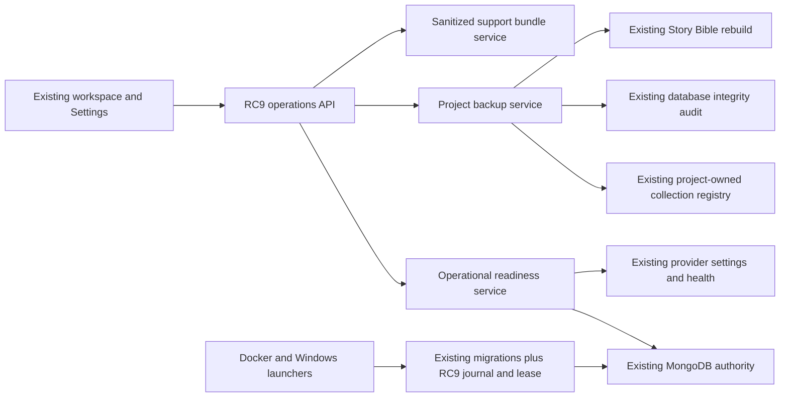

# NovelForge V2 RC9 — Architecture Notes

## Scope

RC9 adds an operational shell around the frozen RC8 product. Narrative Analysis Engine, shared Narrative Intelligence graph, Story Bible authority, Canon Governance, provider gateway, Workspace Bootstrap, current agent roster, database architecture and Paragraph Editor ownership are unchanged.

## Bounded additions

### Operations API

The additive `/api/operations` surface exposes readiness, privacy, all-project backup, support bundle and feedback operations. Project-specific backup/validate/download/import/restore routes reuse normal project identity and response conventions. Existing APIs remain compatible.

### Backup service

Backup serialization uses BSON Extended JSON so MongoDB types round-trip without inventing a second schema. The archive is a transport/recovery format, not a live authority. Restore maps old project/entity identities to a new project, inserts in batches, rebuilds derived Story Bible state where needed and invokes the existing database audit. Failure deletes only records owned by the new copy.

Restore operation identity is stored under a sparse unique index. Concurrent/retried callers wait for or reuse the established result. This follows the existing RC8 idempotency pattern and closes lost-response duplication without an API break.

### Readiness

Readiness is a projection over existing database, migration, storage and provider state. It is not another health authority. Database availability is probed once; when unavailable the service returns a structured blocked projection without performing more database calls. AI state is deliberately separate from local project availability.

### Migration execution

RC9 retains the existing sequential migrations and adds durable `migration_runs`, application/schema metadata and a leased `migration_locks` record. The lease allows an abandoned startup to recover while preventing simultaneous migration ownership. The migration itself is additive and idempotent.

### Privacy and diagnostics

Support bundles are allow-list projections of operational metadata followed by recursive redaction. They never query story collections for prose or export prompts/responses. Correlation IDs join UI, API and existing operation/provider outcome records without making technical identifiers the author's primary explanation.

### Packaging

Docker Compose is the supported local boundary. Named volumes hold MongoDB data and application secret/data files. Only frontend/API bind to `127.0.0.1`; MongoDB has no host-published port. Health checks enforce startup order. The start launcher reuses images, while update performs the explicit build path after backup.

## Compatibility

- App version: `2.0.0-rc9`
- Schema version: `9`
- Backup format: `1`
- Existing endpoints and persisted documents remain readable.
- Legacy projects receive additive version metadata; creative content is not rewritten.
- Paragraph Editor code and data contracts are untouched by RC9.

## Operational invariants

1. A backup never contains provider credentials.
2. A restore never overwrites the source project.
3. An invalid or partially verified restore never becomes an author project.
4. One restore request identity creates at most one copy.
5. AI availability never defines whether existing local work is accessible.
6. Migration ownership is durable and recoverable.
7. Support bundles contain operational evidence, not the author's story.
