# NovelForge

**An AI-assisted workspace for writing long novels without losing track of the story.**

NovelForge helps an author plan a novel, write chapters with AI help, and keep
hundreds of story facts consistent. After each approved chapter it extracts
characters, places, promises and mysteries into a **Story Bible**, so later AI
calls get the facts they need instead of the whole book. The author stays in
control: AI output is a suggestion until the author approves it.

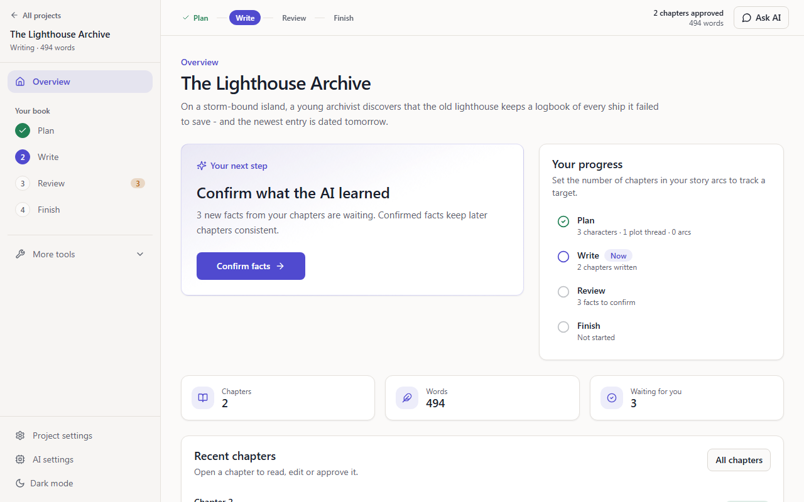

## What it does

Each project follows one guided path, numbered in the sidebar:
**Overview → Plan → Write → Review → Finish**. A progress bar at the top
always shows the book's stage, chapters approved against the plan and the word
count, and the Overview names the single next step. Specialist tools are
tucked under "More tools". Light and dark themes are included.

- **Plan the story**: story vision, characters, world rules, themes, plot
  threads, mysteries and a timeline. A "Develop Story" button runs a team of
  specialised AI agents (story architect, character, world, pacing, ...) that
  fill gaps in the plan.
- **Write chapters**: "Start writing now" drafts a chapter from an instruction
  and a word range, using the approved story so far as context. Every edit is a
  new version; nothing approved is overwritten.
- **Extract story knowledge**: when a chapter is approved, an extraction step
  pulls out candidate facts (new characters, relationships, promises, open
  mysteries). The author confirms or rejects each one before it becomes canon.
- **Check consistency**: a Story Health dashboard scores continuity, canon
  conflicts, open promises and pacing from the saved data.
- **Finish the book**: assemble approved chapters into a manuscript and, once
  the publication readiness checks pass (canon completeness, open mysteries
  resolved or deferred), export Markdown, plain text, HTML, DOCX, EPUB or PDF.
- **Use any AI provider**: Google Gemini, OpenRouter, OpenAI, Anthropic, Groq
  or a local Ollama model, with automatic retry and fallback to the next
  provider. An offline mock provider lets you run everything without an API key.

## Screenshots

| | |
| --- | --- |
| 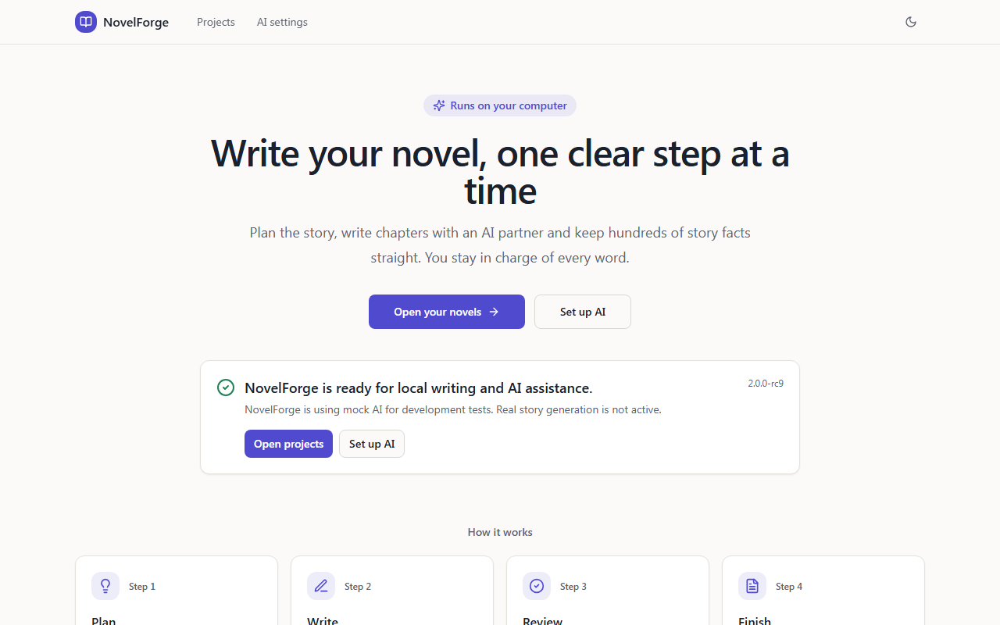 **Home** with a first-run check | 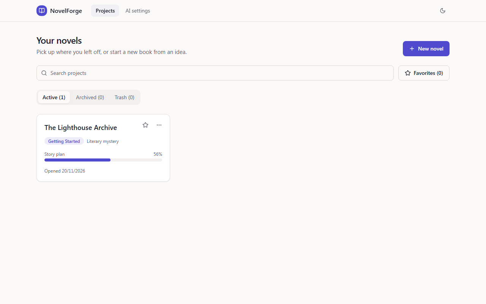 **Your novels** |
| 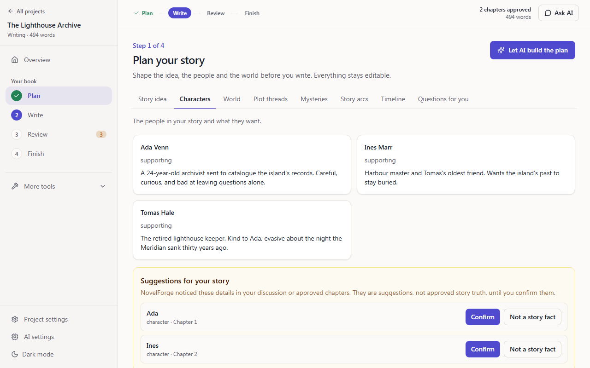 **1 · Plan**: story idea, characters, world, plot | 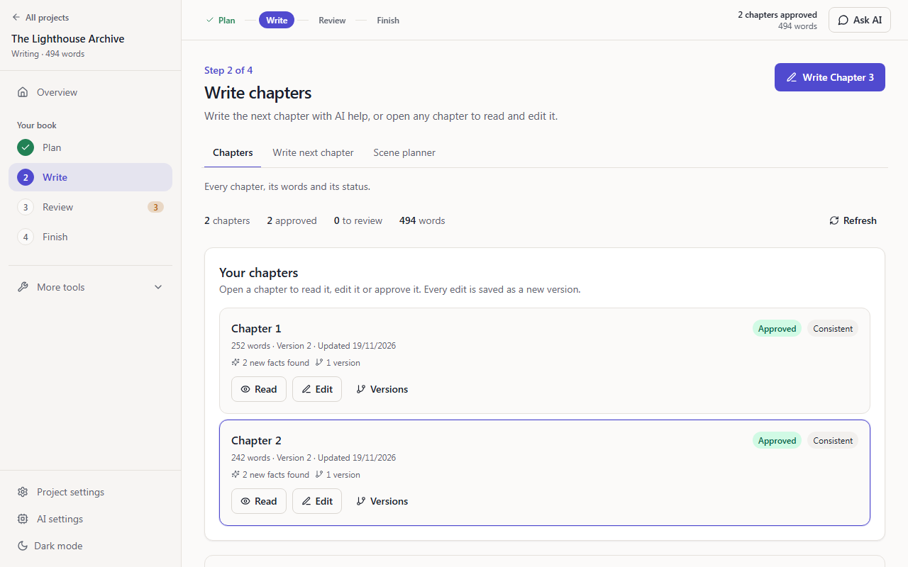 **2 · Write**: chapters, word counts, approval |
| 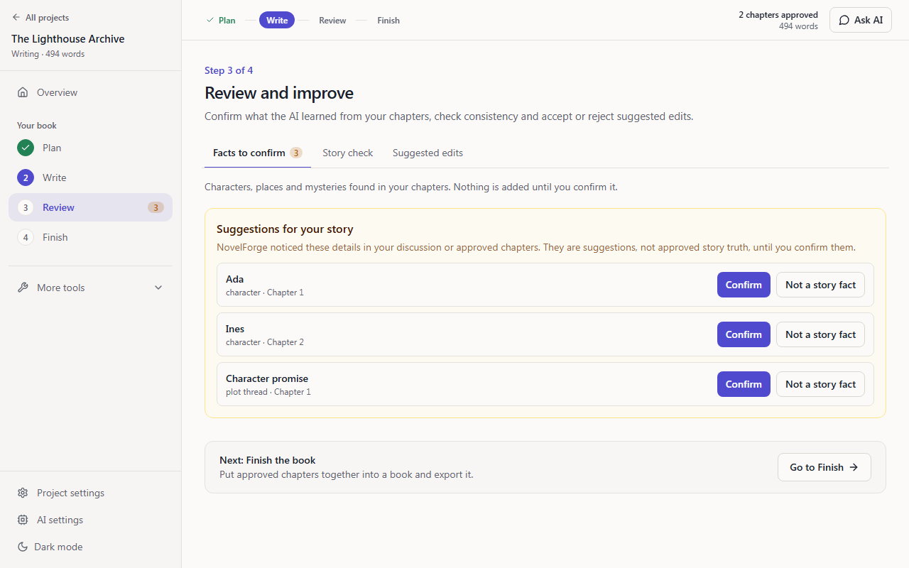 **3 · Review**: facts the AI found, waiting for you | 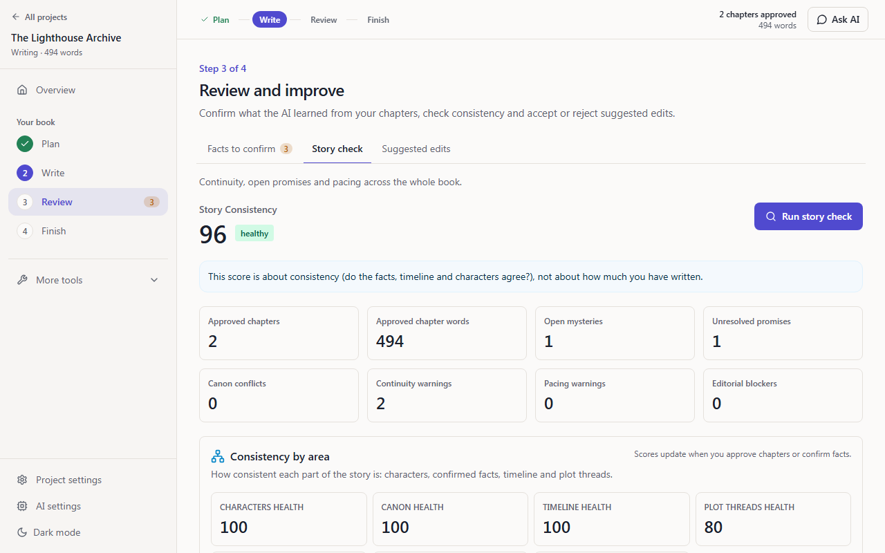 **3 · Review**: story consistency check |
| 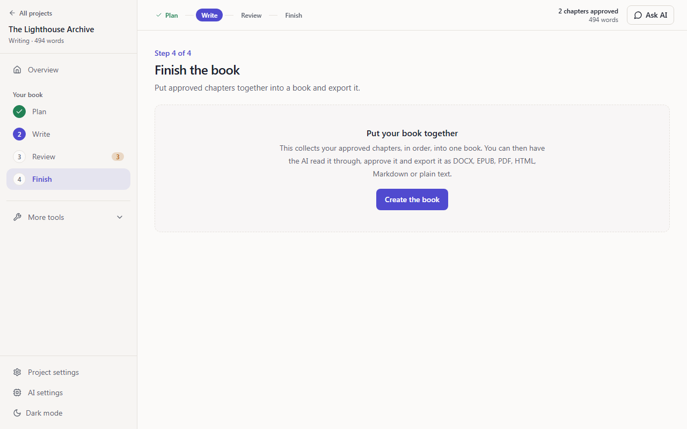 **4 · Finish**: assemble and export the book | 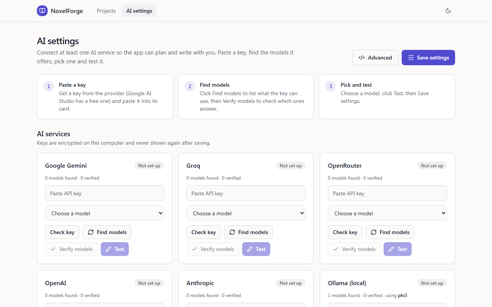 **AI settings**: paste a key, pick and test a model |
| 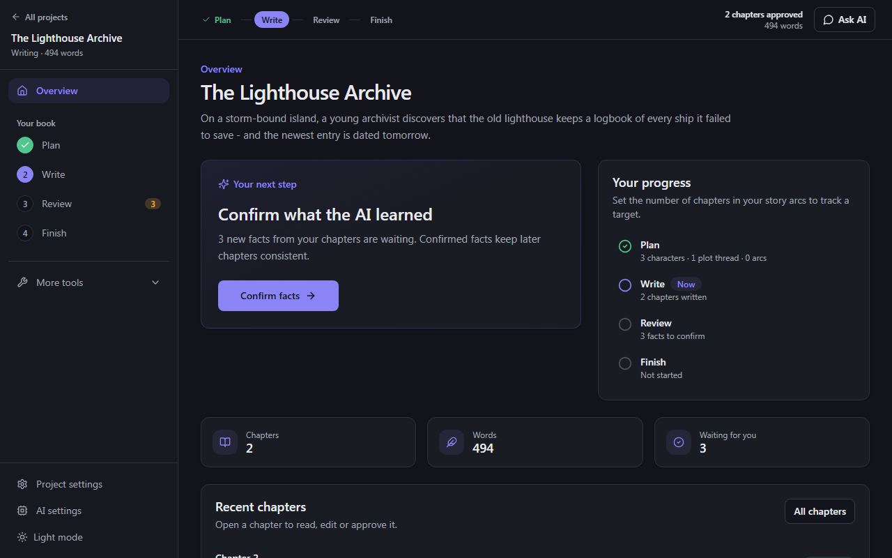 **Dark mode** | 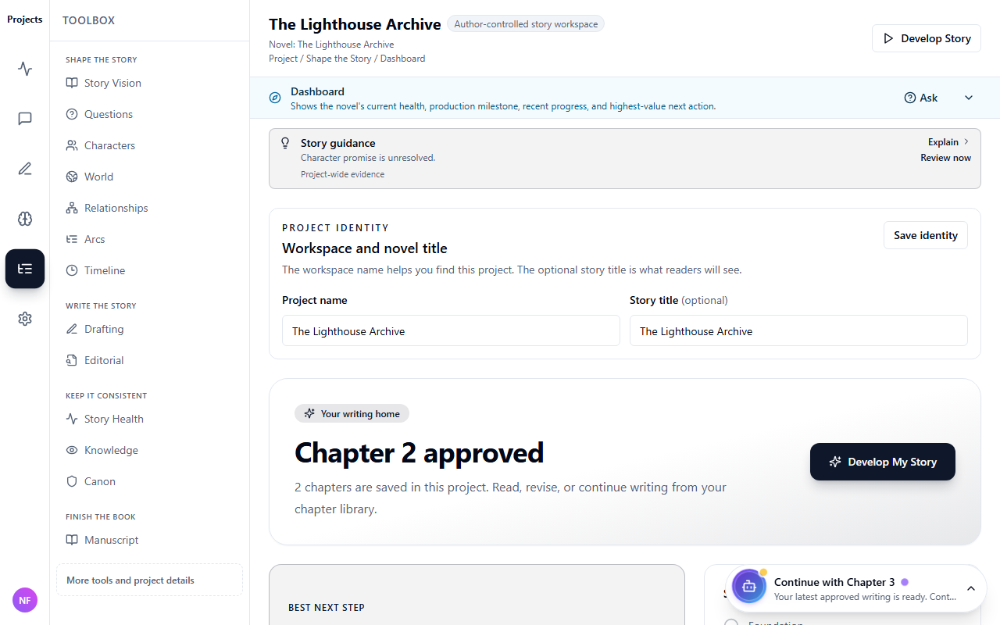 **Before the redesign** (for comparison) |

Short walkthrough (about 30 seconds) of the guided path:

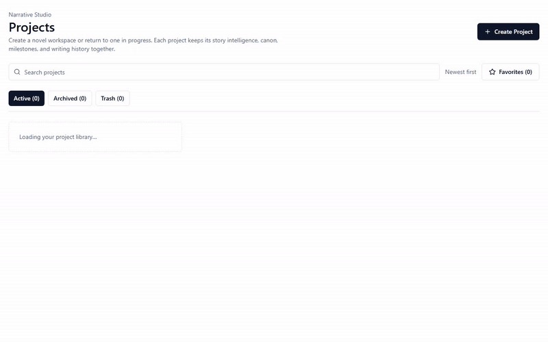

*Screenshots above use the sample project from `backend/scripts/seed_demo_project.py`
with the offline mock AI provider.*

**With a real model** (OpenRouter `deepseek/deepseek-v4-flash` for writing,
Gemini Flash-Lite for extraction): a chapter written from a one-line
instruction, and the story facts extracted from it waiting for the author.
These two were captured before the redesign, so they show the older layout;
the AI output is the same.

| | |
| --- | --- |
| 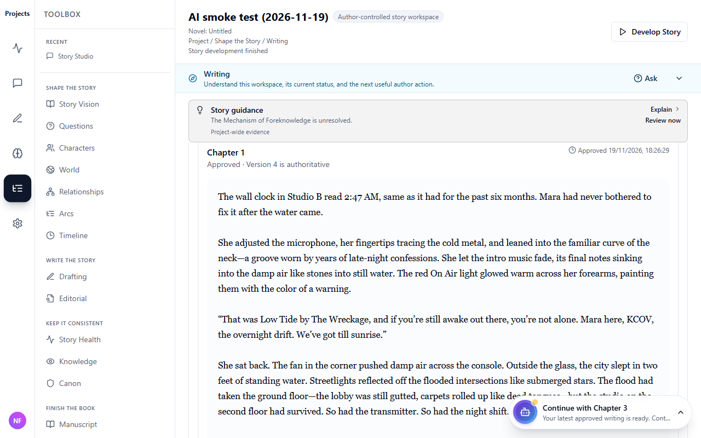 **AI-written chapter** after one focused AI revision (version 4) | 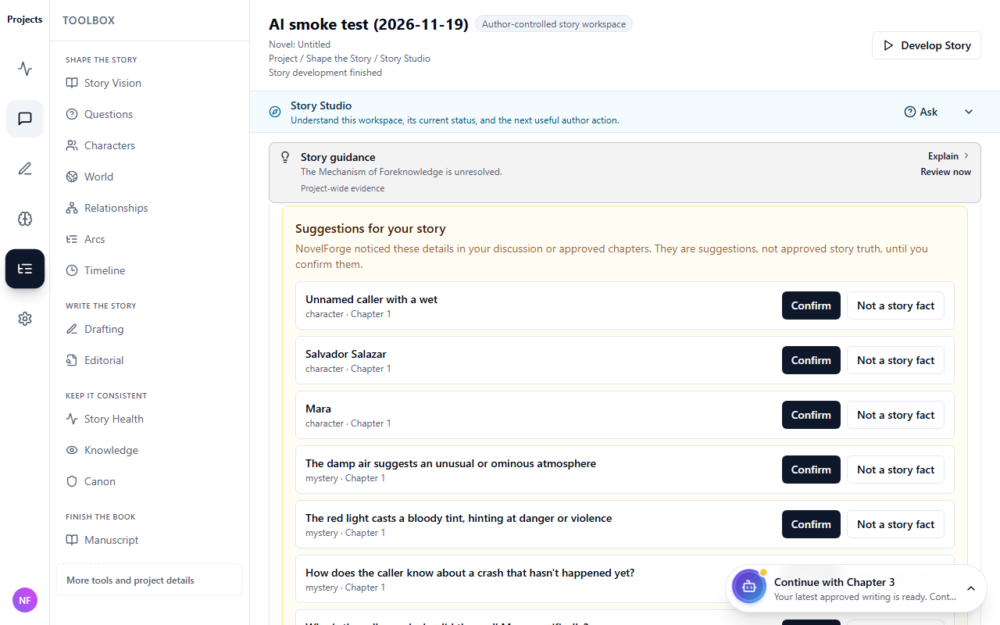 **Extracted characters and open mysteries** to confirm or reject |

## Architecture

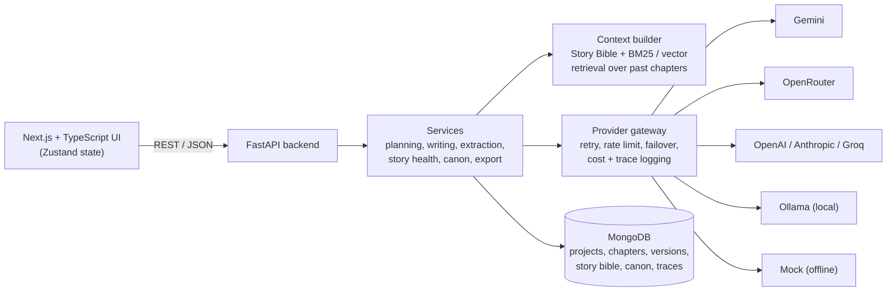

- **Frontend** (`frontend/`): Next.js 15 (App Router), React 18, TypeScript,
  Tailwind CSS, Zustand, TipTap editor. Unit tests with Vitest + Testing Library.
- **Backend** (`backend/`): Python 3.11, FastAPI, Motor (async MongoDB driver),
  Pydantic v2, httpx. About 80 small services under `backend/app/services/`.
  Pytest suite under `backend/tests/`.
- **Database**: MongoDB. Schema changes run as idempotent startup migrations
  guarded by a lock so two processes can't migrate at once.
- **AI provider gateway** (`backend/app/services/provider_gateway.py`): one
  entry point for every model call. Retries transient errors with backoff,
  falls back to the next configured provider, enforces a requests-per-minute
  limit, validates JSON output, and records latency, tokens and estimated cost.
- **Security for a local app**: API keys are encrypted at rest (Fernet) and
  never returned by the API, optional local access token, CORS and trusted-host
  checks, and every request gets a reference ID for support.
- **End-to-end tests** (`e2e/`): Playwright, run against a separate `*_e2e`
  database.

A plain-language walkthrough of the main flow and the design decisions is in
**[docs/HOW_IT_WORKS.md](docs/HOW_IT_WORKS.md)**; the UX audit behind the
current layout is in [docs/UX_REDESIGN_PLAN.md](docs/UX_REDESIGN_PLAN.md).

## Run it locally

Prerequisites: **Python 3.11**, **Node.js 20+**, and **MongoDB 7+** running on
`localhost:27017`. No API key is needed to try it: the example config uses the
offline mock provider.

```powershell
# 1. Backend dependencies (in a virtual environment)
py -3.11 -m venv backend\.venv
backend\.venv\Scripts\python -m pip install -r backend\requirements.txt

# 2. Frontend and tooling dependencies
npm install
npm install --prefix frontend

# 3. Configuration (USE_MOCK_LLM=true means offline mock AI)
copy backend\.env.example backend\.env

# 4. Start backend (port 8000) and frontend (port 3000)
npm run dev
```

Open http://localhost:3000. To load the sample project shown in the
screenshots, run this in a second terminal while the app is running:

```powershell
backend\.venv\Scripts\python backend\scripts\seed_demo_project.py
```

On macOS/Linux use `python3 -m venv backend/.venv`,
`backend/.venv/bin/python ...` and `cp` instead of `copy`. The dev launcher
picks up `backend/.venv` automatically.

**Real AI**: open **AI Settings**, paste a provider key (for example a free
Google AI Studio key for Gemini), click *Find models*, verify one, and save.
Set `USE_MOCK_LLM=false` in `backend/.env` to hide the mock provider.
Interactive API docs are at http://localhost:8000/docs.

**Docker** (all three services): `docker compose up --build`, or on Windows
double-click `scripts\windows\start-novelforge.cmd`. See
[docs/operations/](docs/operations/) for backup, upgrade and troubleshooting.

## Tests

```powershell
npm run test:backend    # pytest (~220 tests), uses a throwaway MongoDB database
npm run test:frontend   # Vitest (92 tests)
npm run lint            # ESLint, zero warnings allowed
npm run build           # Next.js production build + type check
npm run test:e2e        # Playwright (starts the app itself; ports 3000/8000 must be free)
```

GitHub Actions runs lint, backend and frontend tests, the production build and
the Playwright suite against a MongoDB service container.

### Known issues

- **Playwright suite**: run offline (mock AI), 32 of 52 tests pass, 20 skip
  and none fail. The skipped tests need a real AI provider: either they call
  Gemini directly, or they generate scene prose, which the offline mock cannot
  write in a schema-valid form. They skip themselves when no real provider key
  is saved (`e2e/realAi.ts`). The real-provider tests were last run (13 of 14
  passing) before the UI redesign and have not been re-run against it. On
  Windows, Playwright can leave its dev server running after the last test;
  free ports 3000/8000 before the next run. Backend (pytest), frontend
  (Vitest), lint and build all pass.
- With a single provider selected ("full" execution mode), planning and scene
  agents have no fallback provider, so an outage of that provider (for example
  Gemini HTTP 503) fails the request after two retries. "Hybrid" mode adds
  fallbacks. Chapter writing and story-fact extraction always have fallbacks.
- `npm run dev` auto-reloads the backend when files in `backend/app` change.
  Set `NOVELFORGE_NO_RELOAD=1` to turn that off.

## Repository layout

```
backend/            FastAPI app (app/api routes, app/services logic, app/migrations)
  scripts/          one-off tools, including seed_demo_project.py
  tests/            pytest suite
frontend/           Next.js app (app/ pages, components/, store/, lib/api.ts)
e2e/                Playwright end-to-end tests
scripts/            dev launcher, health check, benchmarks, Windows/Docker helpers
docs/               architecture notes, API notes, operations guides, screenshots
docs/reports/       archived development reports (phase/release notes, audits)
```

## Project status

A personal project, built iteratively with heavy use of AI coding assistants;
the per-phase design notes and audit reports from that process are archived in
[docs/reports/](docs/reports/). It runs locally as a single-user desktop app,
not a hosted multi-user service.
