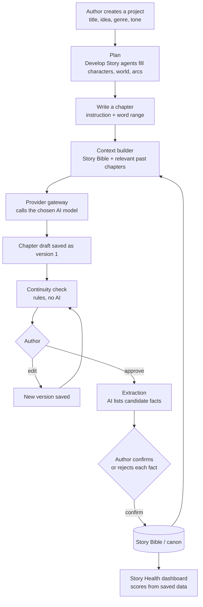

# How NovelForge works

A plain-language tour of the main flow and the reasons behind the design.
File paths point to where each piece lives, so you can open the code while
reading.

## The problem it solves

Large language models write good paragraphs but forget things. In a 40-chapter
novel the model cannot see chapter 3 when it writes chapter 30, so characters
change eye colour, dead people come back, and promises are never paid off.
Sending the whole book every time is slow and expensive and still hits the
model's context limit.

NovelForge's answer: **keep a structured memory of the story (the Story
Bible) in a database, and send the model only the facts that matter for the
chapter being written.** The author approves what goes into that memory, so
the AI cannot quietly change the story's facts.

## The main flow, step by step



### 1. Create a project

`POST /api/projects` (`backend/app/api/projects.py`) stores the project in the
`projects` collection. The frontend calls it from the Projects page
(`frontend/app/projects/page.tsx`) through the typed API client in
`frontend/lib/api.ts`.

### 2. Plan the story ("Develop Story")

The planning button starts a background run (`backend/app/api/workflow.py`).

- `orchestration_service_v2.py` works out **which** planning agents need to run.
  It looks at what is missing or what changed (no characters yet? the premise
  changed?) and maps that to agents: character changes wake the
  CharacterJourney and Relationship agents, world changes wake the World and
  Faction agents, and so on. It caps the number of agent calls per run so a
  run cannot loop forever or burn money.
- `narrative_studio.py` runs each agent. An "agent" here is not a separate
  program: it is a prompt with a purpose, a JSON schema for the answer, and the
  relevant project context. The answer is validated against the schema and
  saved into normal collections (`character_bibles`, `world_bibles`,
  `plot_threads`, ...). If the answer fails validation, `narrative_studio.py`
  sends one corrective request that includes the validation error, so the
  model can fix its own output.

The author can also add or edit everything by hand
(`POST /api/projects/{id}/workspace-entries`). The demo seed script uses that
path.

### 3. Write a chapter ("Start writing now")

`discovery_writing_service.py` drafts a chapter:

1. **Build the context** (`context_engine.py`): the story vision, approved
   characters and world rules, open plot threads, and the most relevant
   passages from earlier chapters. Relevance comes from a retrieval step
   (`memory_retrieval_service.py`, `memory_phase_c_ranker.py`) that combines
   **BM25 keyword scores** with a lightweight vector similarity and merges the
   rankings with **reciprocal rank fusion**. Only approved facts are used;
   unconfirmed suggestions are filtered out by an `authority_status` field.
2. **Call the model** through the provider gateway (next section).
3. **Enforce the length**: if the draft is outside the requested word range,
   the service asks for a continuation or a compression pass, up to a few
   attempts.
4. **Save as a version**: drafts go into `chapter_drafts` with a version
   number. Editing creates a new version; approving marks one version as the
   active one. Older versions are never deleted, so you can roll back.
5. **Check continuity** (`draft_validation_service.py`): rule-based checks for
   things like contradicting approved facts or a point-of-view change. No AI is
   involved, so the check is fast, free and repeatable.

### 4. Approve the chapter and extract knowledge

On approval, `extract_approved()` in `discovery_writing_service.py` asks the
model (in JSON mode) to list **candidate** facts from the prose: characters,
relationships, objects, promises, mysteries, timeline events. If the model
fails or returns nothing, a simple rule-based extractor is used instead, so the
step never blocks the author.

`story_knowledge_projection_service.py` saves those candidates with
`authority_status: "candidate"`. They show up in Story Studio as
*Suggestions for your story* with **Confirm** / **Not a story fact** buttons.
Only confirmed facts become part of the Story Bible and are sent to the AI
next time. This is the "human in the loop" part of the design.

### 5. Check the whole story

`story_health_service.py` and `narrative_analysis_engine.py` compute the
Story Health dashboard (approved chapters, open mysteries, unresolved promises,
canon conflicts, continuity warnings) **from the database, without calling an
AI model**. That keeps the scores consistent between runs and costs nothing.

### 6. Export

`publication_service.py` assembles approved chapters into a manuscript and
writes Markdown, text, HTML, DOCX, EPUB and PDF (PDF via ReportLab).

## The provider gateway (multi-LLM failover)

Every model call in the backend goes through one function:
`provider_gateway.generate_with_failover()` in
`backend/app/services/provider_gateway.py`.

```
attempts = [chosen model] + fallback models
for each attempt:
    wait for the rate limiter (requests per minute per provider)
    call the provider (Gemini, OpenRouter, OpenAI, Anthropic, Groq, Ollama, or mock)
    on a temporary error (timeout, 429, 5xx, empty or invalid JSON):
        retry up to 2 times, waiting 2s then 4s (exponential backoff)
    on success: record latency, tokens, estimated cost -> return
    on a permanent error (bad key, unknown model): move to the next provider
if all fail: raise one clear error that lists what each provider said
```

Why one gateway:

- **Resilience**: free tiers hit rate limits often. Retrying and falling back
  means the author's click still produces a result.
- **One place for cross-cutting concerns**: rate limiting, JSON validation,
  cost tracking and logging are written once, not in 30 services.
- **Observability**: each call writes an execution trace (provider, model,
  tokens, latency, retries, whether a fallback was used) that the Workflow view
  can show.
- **Offline development**: the `mock` provider returns deterministic answers
  when `USE_MOCK_LLM=true`, so the app and its tests run with no API key and no
  cost.

`task_routing_service.py` picks the model per task: cheap/fast models for
small jobs like extraction, the author's chosen default for chapter writing.

## Key design decisions (and the trade-offs)

| Decision | Why | Trade-off |
| --- | --- | --- |
| **MongoDB** (document database) | Story data is nested and varies by type (a character, a world rule and a chapter version look very different). Documents map directly to the Python dicts and JSON the API already uses. | No joins or foreign keys; consistency between collections is enforced in service code and by startup migrations. |
| **Author approves AI output** before it becomes canon | Prevents the model from silently rewriting story facts; the author always knows what is "official". | More clicks for the author. |
| **Versioned drafts, never overwrite** | Safe experimentation; easy rollback. | More storage; queries must pick the active version. |
| **Rule-based checks for health/continuity** | Deterministic, free, fast, testable. | Catches fewer subtle problems than an LLM review would. |
| **Retrieval (BM25 + vectors) instead of sending the whole book** | Fits the model's context window and keeps cost per chapter flat as the book grows. | A relevant passage can be missed if it shares no words or meaning with the query. |
| **Startup migrations with a lock** | Old local databases upgrade automatically and safely; two app instances can't migrate at the same time. | Startup does a little extra work. |
| **Encrypted API keys** (Fernet, key file on disk) | Keys are not stored in plain text in the database and are never sent back to the browser. | Losing the key file means re-entering API keys. |
| **FastAPI + async Motor driver** | Model calls take seconds; async lets the server handle other requests (progress polling, page loads) meanwhile. | Async code is harder to debug than plain synchronous code. |

## Where things live

| You want to see... | Look at |
| --- | --- |
| API routes | `backend/app/api/*.py` (wired up in `backend/main.py`) |
| Model calls, retries, failover | `backend/app/services/provider_gateway.py` |
| Chapter writing + extraction | `backend/app/services/discovery_writing_service.py` |
| Planning agents | `backend/app/services/narrative_studio.py`, `orchestration_service_v2.py` |
| Context and retrieval | `backend/app/services/context_engine.py`, `memory_retrieval_service.py` |
| Story Bible | `backend/app/services/story_bible_service.py`, `story_knowledge_projection_service.py` |
| Settings and key encryption | `backend/app/services/settings_service.py`, `secret_encryption_service.py` |
| Database connection + migrations | `backend/app/core/database.py`, `backend/app/migrations/` |
| Frontend API client | `frontend/lib/api.ts` |
| Main project workspace UI | `frontend/app/project/[projectId]/page.tsx`, `frontend/components/` |
| Tests | `backend/tests/`, `frontend/**/*.test.tsx`, `e2e/*.spec.ts` |

## Questions an interviewer might ask

**How do you stop the AI from contradicting earlier chapters?**
Approved facts are stored in a Story Bible and the relevant ones are put into
every prompt. New facts from a chapter are only suggestions until the author
confirms them, and a rule-based continuity check runs on every draft.

**What happens if Gemini is down or rate-limited?**
The gateway retries temporary errors twice with backoff, then tries the next
configured provider (for example OpenRouter). Every attempt is logged, and if
everything fails the author gets one clear error. Approved work is never lost.

**How do you keep costs down?**
Retrieval sends only relevant context instead of the whole book; cheap models
handle small tasks like extraction; health checks use no AI at all; a
requests-per-minute limiter and a per-run cap on agent calls stop runaway
spending; each call's tokens and estimated cost are recorded.

**How do you test code that calls an LLM?**
With `USE_MOCK_LLM=true`, a deterministic mock provider stands in for real
models. The pytest suite runs against a throwaway MongoDB database that is
dropped afterwards, and Playwright tests use a separate `*_e2e` database.

**Why MongoDB and not PostgreSQL?**
The data is document-shaped and varies a lot between record types, and the API
already speaks JSON. The cost is no foreign keys, so cross-collection
consistency is handled in code and migrations.

**What would you improve next?**
Split the largest services (`drafting_service.py`, `narrative_studio.py`) into
smaller modules, remove the unused LangGraph prototype in `backend/app/graph/`,
replace the hash-based vectors with a real embedding model, and add real-time
progress updates (WebSockets) instead of polling.
