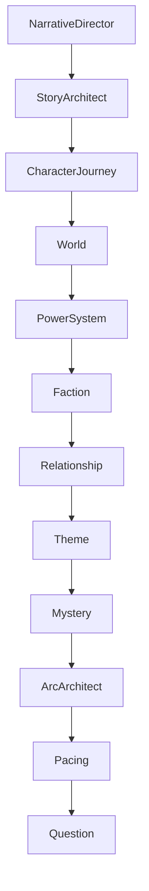

# Subsystem Architecture: Agent Workflow & Orchestration

NovelForge is powered by a multi-agent system orchestrating complex story construction through coordinated roles.

## Dynamic Execution Path

Agents run within a **Narrative Cycle**. The execution sequence is structured as follows:

## Agent Definitions

1. **NarrativeDirector**: Establishes vision and validates pacing metrics.
2. **StoryArchitect**: Structures act roadmap and chapter timelines.
3. **CharacterJourney**: Manages characters, progressions, and dynamics.
4. **World**: Details world-building, settings, and locations.
5. **PowerSystem**: Details progression curve and rank limitations.
6. **Faction**: Defines faction systems, motives, and alignments.
7. **Relationship**: Maps character relationships and graphs.
8. **Theme**: Coordinates thematic beat distribution.
9. **Mystery**: Manages mysteries, clues, and revelations.
10. **ArcArchitect**: Designs arcs and chronologies.
11. **Pacing**: Audits text pacing, scene layout, and transitions.
12. **Question**: Formulates user-clarifying questions.
13. **ScenePlanner**: Splits approved scenes into paragraph skeletons.
14. **SceneWriter**: Writes prose based on skeletons and continuity memory.

## Orchestration Controls

- **Rate Limiting & Cooldowns**: Bounded gateway retries and provider throttling prevent API outages.
- **Cycle Budgeting**: Limits dollar spend per agent cycle.
- **Skipped Execution**: Unchanged context allows agents to terminate without calls.
- **Corrective Retries**: Schema validation failures trigger a self-correction retry with error detail.
