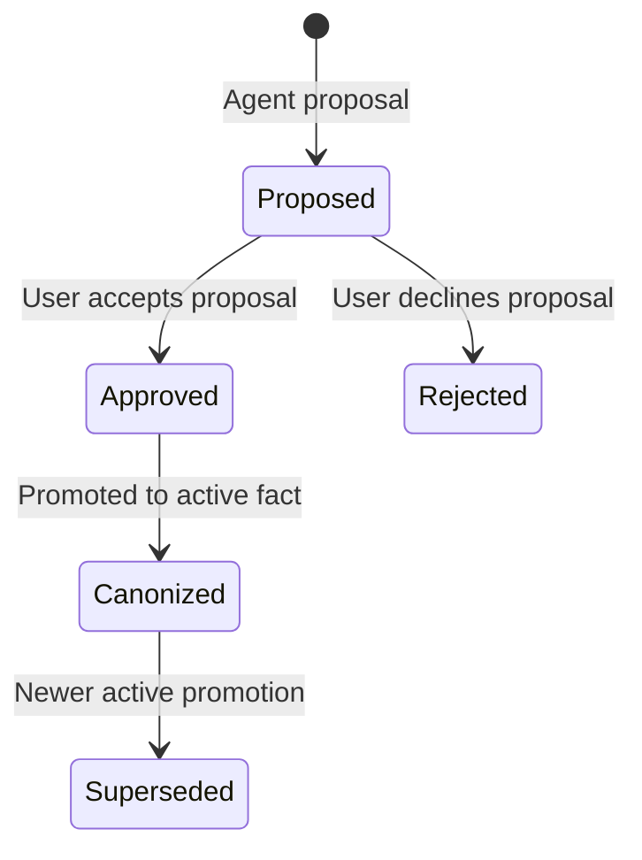

# Subsystem Architecture: Canon & Governance System

The Canon and Governance system ensures story fact integrity, consistency, and conflict detection.

Phase 6 Canon Intelligence is a consumer of the shared Narrative Analysis Engine. It does not calculate a separate Canon Health score or duplicate timeline/continuity analysis. See [Narrative Intelligence](./narrative-intelligence.md).

## Canon Registry

Approved proposals and resolved questions promote narrative elements into the **Canon Registry** (`canon_registry`).
- Represents the absolute truth of the story.
- Loaded into prompt contexts for all downstream agent cycles.
- Organized by domain (character, power, location, timeline, etc.).

## Governance Lifecycle

## Deterministic Conflict Detection

NovelForge checks for factual errors before approving proposals:
- **Character state**: Contradictions in age, status, or locations.
- **Timeline order**: Overlapping chronological occurrences.
- **Power rules**: Progressions that violate system concepts or curve limits.
- **Mystery reveals**: Disclosures that occur before clues are seeded.
- **Ownership**: Conflict of artifact custody or locations.

Contradictions generate a continuity report, blocking the approval of new proposals until resolved.

## Phase 6 conflict evidence

Each typed conflict preserves the original source, conflicting sources, affected locations, narrative impact, confidence/evidence, acknowledgement state, and resolution state. Canon findings automatically reduce Canon Health and Overall Story Health. Rebuilding the Story Bible after approved canon changes also refreshes the shared analysis snapshot.
