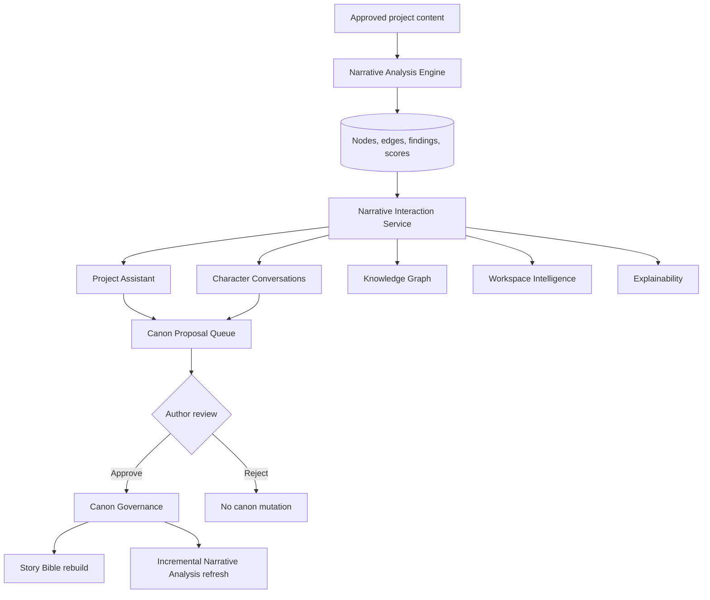

# Subsystem Architecture: Interactive Narrative Studio

## Boundary

Phase 7 is a consumer layer over the frozen Phase 6 Narrative Analysis Engine. It does not create a second story-analysis pipeline and does not change Paragraph Editor behavior. Approved project records remain inputs to Narrative Analysis; persisted `narrative_nodes`, `narrative_edges`, `narrative_findings`, and the current analysis snapshot are the authoritative interaction context.

## Shared interaction flow

`NarrativeInteractionService` is the Phase 7 orchestration boundary. It selects and bounds existing analysis evidence, invokes the configured provider when conversational language is required, persists interaction history, and delegates all narrative state changes to existing governance services.

## Character knowledge boundary

A character conversation builds context from the current graph and Story Bible while enforcing a requested timeline position:

- chapter, event, and character-knowledge records after the effective chapter are excluded;
- a character's death chapter caps awareness even if the author requests a later chapter;
- approved canon is included only when its source is available at the effective chapter or belongs to the character's own established record;
- prior conversation memories, promises, opinions, relationship changes, emotions, and unresolved conflicts are loaded as bounded context;
- the response records the effective awareness chapter and whether a death boundary was enforced.

Conversation memories are stored project- and character-scoped and projected into the generated Story Bible. They supplement interaction context but do not become official canon automatically.

## Assistant and navigation

The Project Assistant receives a compact evidence bundle from the current analysis snapshot: health scores, matching findings, graph nodes, chapters, timeline records, canon records, plot threads, and navigation candidates. Six modes change the system instruction while keeping the evidence source constant.

Navigation is deterministic application behavior. The service converts explicit chapter, scene, Story Health, Canon, Timeline, Character Intelligence, Story Bible, Knowledge Graph, Plot Thread, and Mystery requests into typed navigation actions. The UI executes those actions; model text is never evaluated as a route or command.

## Knowledge Graph and explainability

The live graph is a bounded projection of `narrative_nodes` and `narrative_edges`; no Phase 7 graph collection exists. Node detail resolves connected entities, chapters, scenes, timeline and canon references, and associated Story Health findings from those same persisted records.

Workspace recommendations and the `Why was this generated?` panel reuse narrative finding identifiers. An explanation returns the finding's rule/category, severity, explanation, evidence, affected chapters/scenes/elements, recommended actions, confidence, source nodes, and current analysis identifier. AI answers also store their exact evidence identifiers and provider execution trace.

## Canon proposal governance

All facts suggested by the Project Assistant or a character response are inserted into `canon_proposals` with confidence, evidence, affected locations, source provenance, and a precomputed Change Impact result. Supported canon types are validated at proposal creation.

Approval uses the existing `CanonGovernanceService.promote` operation, rebuilds the Story Bible, and triggers incremental Narrative Analysis. High-impact approvals require explicit confirmation. Rejection records the decision without writing a canon fact.

## Persistence and indexes

Phase 7 adds interaction state, not a second analysis graph:

- `narrative_conversations` for character turns;
- `character_conversation_memories` for reusable character interaction memory;
- `narrative_assistant_messages` for assistant history and evidence traces;
- `canon_proposals` for the governed queue.

`phase_7.py` installs project-scoped identity, character/history, assistant-history, and proposal-queue indexes. The database audit and project deletion cascade include all Phase 6 and Phase 7 collections.

## API surface

- `GET /api/projects/{project_id}/interactive/modes`
- `POST /api/projects/{project_id}/assistant`
- `GET /api/projects/{project_id}/assistant/history`
- `POST /api/projects/{project_id}/character-conversations`
- `GET /api/projects/{project_id}/character-conversations/{character_name}`
- `GET /api/projects/{project_id}/knowledge-graph`
- `GET /api/projects/{project_id}/knowledge-graph/nodes/{node_id}`
- `GET /api/projects/{project_id}/narrative-findings/{finding_id}/explanation`
- `POST /api/projects/{project_id}/workspace-intelligence`
- `POST|GET /api/projects/{project_id}/canon/proposals`
- `PUT /api/projects/{project_id}/canon/proposals/{proposal_id}`

## Performance model

Graph browsing, recommendations, and explainability are read paths over indexed cached analysis. They do not rebuild novel context. Conversational requests pack only relevant, bounded graph evidence before calling the provider. An approved canon proposal triggers the existing incremental invalidation path rather than a separate full-project analyzer.

The reproducible 500-chapter benchmark is `backend/scripts/run_phase_7_benchmark.py`; the measured result is recorded in `artifacts/phase7-performance-benchmark.json`.

