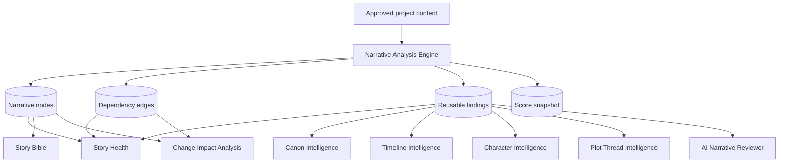
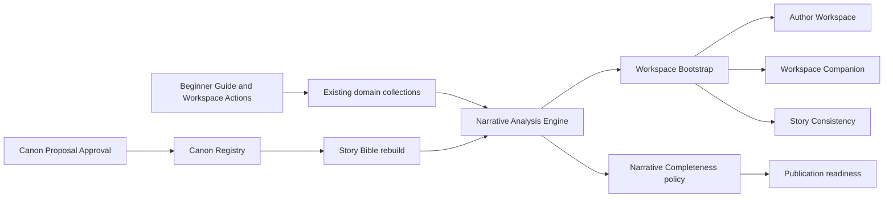

# Subsystem Architecture: Narrative Intelligence Platform

## Boundary

Phase 6 adds whole-novel analysis without changing the frozen Paragraph Editor architecture. Paragraph, suggestion, autosave, and versioning behavior remain owned by the Paragraph Engine. Approved chapter and scene records become inputs to Narrative Intelligence.

## Shared analysis flow

`NarrativeAnalysisEngine` in `backend/app/services/narrative_analysis_engine.py` is the only Phase 6 domain-analysis authority. Story Health and the read-only AI reviewer consume its snapshot and findings instead of implementing parallel scoring rules.

## Knowledge graph contract

Every source record becomes a stable project-scoped node with:

- `node_id`, `kind`, and human-readable `label`;
- source collection and source identity;
- a deterministic source fingerprint;
- affected chapter and scene locations;
- a bounded source payload.

References between source identities and labels become dependency edges. Findings are stable, reusable records with domain, category, severity, explanation, affected chapters/scenes/elements, evidence, recommended actions, confidence, and acknowledgement status.

## Incremental computation

The engine fingerprints source nodes and compares them with the current persisted graph:

- unchanged nodes are reused;
- changed nodes are upserted;
- deleted source nodes are removed;
- a fully unchanged project returns the cached snapshot without rebuilding graph edges or findings;
- a single changed chapter invalidates one source node while project-wide derived checks are recalculated against the graph.

Analysis can run synchronously or through a persisted background job. The latest snapshot reports source documents, nodes, edges, findings, recomputed nodes, reused nodes, duration, and cache-hit state.

## Domain consumers

- **Story Health**: overall and Character, Canon, Timeline, Plot, Pacing, Continuity, and Balance scores. Every deduction is backed by reusable findings.
- **Canon Intelligence**: typed registry, conflicts, original/conflicting source evidence, impact, affected locations, acknowledgement, and resolution.
- **Timeline Intelligence**: missing dependencies, overlapping positions, impossible ranges, chronology gaps, and dependency visualization.
- **Character Intelligence**: presence gaps and evidence-backed personality drift, with existing journeys, relationships, and progression records retained as context.
- **Plot Thread Intelligence**: unresolved mysteries, promises, foreshadowing, abandoned threads, references, and resolution state.
- **Story Bible**: automatically rebuilt from project knowledge, with an explicit `approved_story_content` slice and the current Narrative Intelligence snapshot/findings.
- **Change Impact**: chapter, scene, character, thread, canon, timeline, manuscript, and editorial consequences plus estimated risk and confirmation requirement.
- **AI Narrative Reviewer**: a read-only StoryAuditorAgent reviewing pacing, repetition, emotional rhythm, structure, continuity, unresolved threads, balance, and tension using the shared graph.

The reviewer receives a prompt projection, not a second analysis model. It preserves the shared snapshot, highest-severity findings and evidence, affected locations, recommended actions, recent chapter signals, long-range obligations, and active canon conflicts. The projection has a 22,000-character internal budget below the provider prompt guard, reports included-versus-available finding coverage, and prevents large novels from failing because the graph was duplicated into the prompt.

## Persistence and indexes

Phase 6 adds `narrative_nodes`, `narrative_edges`, `narrative_findings`, `narrative_analysis_snapshots`, and `narrative_analysis_jobs`. `phase_6.py` installs project-scoped identity, domain/status, and latest-snapshot indexes and is idempotently invoked at startup.

## API

- `GET /api/projects/{project_id}/narrative-intelligence`
- `GET /api/projects/{project_id}/narrative-intelligence/{domain}`
- `POST /api/projects/{project_id}/narrative-analysis`
- `GET /api/projects/{project_id}/narrative-analysis/jobs/{job_id}`
- `PUT /api/projects/{project_id}/narrative-findings/{finding_id}/status`
- `GET /api/projects/{project_id}/story-health` (compatibility metrics plus authoritative Phase 6 scores/findings)

All records and queries are project-scoped. No analysis reads another project's data.

## Performance model

The supported scale target is 500+ chapters and thousands of source records. Node fingerprints and the current snapshot provide cache reuse; background jobs prevent UI request blocking for deliberately queued analysis. Dependency indexes keep graph and finding lookup project-local. Exact-reference edge construction uses an inverted identity/name index rather than comparing every source string to every node.

The measured local 500-chapter/499-edge benchmark completed a full analysis in 0.9538 seconds, a cache hit in 0.1060 seconds, and a single-chapter invalidation in 0.2140 seconds while reusing 499 of 500 nodes. The reproducible entrypoint is `backend/scripts/run_phase_6_benchmark.py`; measured output is preserved in `artifacts/phase6-performance-benchmark.json`.

## Phase 7 consumer layer

The Interactive Narrative Studio consumes this persisted graph for character conversations, Project Assistant evidence, interactive graph browsing, contextual recommendations, and explanations. It does not add analysis rules or maintain a second graph. Proposed facts are routed through Canon Governance, then rebuild the Story Bible and incrementally refresh this engine only after approval. See `docs/architecture/interactive-narrative-studio.md`.

## RC6 commercial experience layer

RC6 adds orchestration and author-facing projections around the frozen intelligence architecture. It does not add another graph, scoring engine, canon store, or paragraph capability.

### Service boundaries

- `BeginnerExperienceService` maps the seven guided steps into existing story-vision, character, world, decision, arc, and scene records.
- `WorkspaceEntryService` gives empty states one write path into the appropriate existing collection.
- `DecisionHistoryService` versions author choices, provides impact previews, and routes meaningful answers into Shared Narrative Context.
- `WorkspaceBootstrapService` is a read projection that combines project, Bible, health, completeness, and companion state. It is not a new source of truth.
- `ProjectLibraryService` owns server-side project search, pagination, favorites, recency, and badge projections.
- `NarrativeInteractionService` keeps canon approval transactional at the workflow level: official fact, Bible rebuild, analysis refresh, completeness, impact, and project events.

### Score and readiness authority

Story Health measures consistency only. Semantic duplicates are collapsed using `semantic_issue_id`, `source_finding_id`, or the stable finding identity before score deductions.

Narrative Completeness remains the publication-readiness authority. Manuscript approval stamps the readiness policy version so new approvals enforce the current policy while legacy approvals retain backward-compatible export warnings.

### Cache and refresh behavior

The frontend requests one workspace bootstrap projection and deduplicates identical in-flight requests. A completed author action calls the shared workspace refresh path. Persisted project events and analysis snapshots update all consumers without page reloads. Narrative recomputation still uses source fingerprints and dependencies, so a scene or chapter edit does not force every source node to be rebuilt.

### Companion recommendation contract

Recommendations have stable identity, priority, dependencies, direct destination, explanation, lifecycle status, cooldown, snooze, and completion state. The service may reactivate a visible item after cooldown, but does not create another unread notification for the same recommendation.

### Backward compatibility

All RC6 endpoints are additive. No migration rewrites existing records, no existing endpoint is removed, and the Paragraph Editor remains unchanged except for regression verification.
