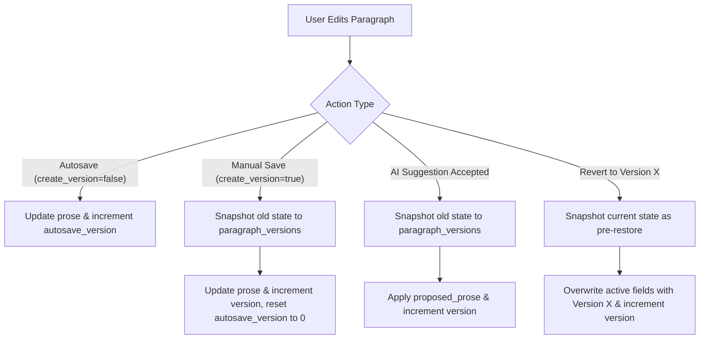

# Subsystem Architecture: Paragraph Engine

> **Frozen architecture:** Phase 6 does not add paragraph editing capabilities. This subsystem accepts only critical defect fixes; whole-novel understanding belongs to the Narrative Intelligence Platform.

The Paragraph Engine is the narrative drafting unit of NovelForge, bridging the scene-level outline and final manuscript drafting.

## Core Concepts

- **Paragraph Skeleton**: A structural plan for a single paragraph. Contains narrative goals, POV, location, tension, and dependencies.
- **Autosave**: Temporary in-place updates to draft prose without generating history entries.
- **Manual Save**: Meaningful, user-driven saves that snapshot prior prose and increment the paragraph version.
- **Suggestions**: Transient alternative prose proposals generated by AI, which users can compare, accept, or reject.

## Data Model

### ParagraphSkeleton (`scene_paragraphs` collection)
```typescript
interface ParagraphSkeleton {
  project_id: string;          // Hex string for project
  scene_id: string;            // UUID or ID of scene
  paragraph_id: string;        // Unique identifier for the paragraph
  order: number;               // Sequential order in scene
  purpose: string;             // Structural purpose
  narrative_goal: string;      // What narrative beat is achieved
  scene_goal: string;          // Relation to overall scene goal
  emotion: string;             // Emotional tone
  tension_level: string;       // Tension indicator (e.g. "5")
  pov: string;                 // Point of View character
  location: string;            // Setting
  prose: string;               // Active draft text
  is_locked: boolean;          // Lock state (metadata only)
  approval_state: string;      // pending, approved, rejected (metadata only)
  version: number;             // Active version counter (increments on meaningful commits)
  autosave_version: number;    // Tracks count of unsaved autosaves since last commit
  dependencies: {
    characters: string[];      // Required characters
    canon_facts: string[];     // References to canon facts
    locations: string[];
    mysteries: string[];
  };
}
```

### ParagraphVersion (`paragraph_versions` collection)
Stores historical snapshots of the skeleton prior to content updates or restoration.
```typescript
interface ParagraphVersion {
  version_id: string;
  paragraph_id: string;
  version_number: number;
  snapshot: Partial<ParagraphSkeleton>;
  created_at: Date;
  created_by: "human" | "ai" | "system";
  change_reason: string;
}
```

### ParagraphSuggestion (`paragraph_suggestions` collection)
A dedicated collection supporting multiple concurrent AI recommendations.
```typescript
interface ParagraphSuggestion {
  suggestion_id: string;       // Unique ID
  paragraph_id: string;        // Owning paragraph
  suggestion_type: string;     // rewrite, expand, tone, etc.
  provider: string;            // e.g. "gemini"
  model: string;               // e.g. "gemini-1.5-flash"
  created_at: Date;
  status: "pending" | "accepted" | "rejected";
  proposed_prose: string;      // Suggested text
  generation_metadata: any;    // Telemetry and cost tracking
}
```

## Versioning Pipeline



- **Locking & Approval** are metadata-only state updates and do not write snapshots to history.
