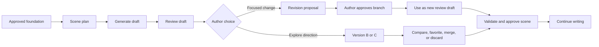

# RC7 Writing Experience Architecture

## Boundary

RC7 is an additive writing-experience layer over the existing planning,
Narrative Intelligence, drafting, editorial, manuscript, and Paragraph Engine
services. It does not introduce a second story model or analysis graph.

The frozen Paragraph Editor remains authoritative for paragraph prose:

- `paragraph_content` is the current editable paragraph content;
- `paragraph_versions` is immutable paragraph history;
- `scene_paragraphs` is the paragraph planning skeleton;
- RC7 scene alternatives never delete or overwrite those records.

Whole-scene alternatives continue to use `scene_drafts`. Structured revisions
continue to use `revision_branches` and `revision_versions`. Approved canon,
Story Bible records, planning records, and the shared Narrative Analysis graph
remain the sources used to assemble generation context.

## Writing flow

Planning checks protect official story truth. An author may generate an
explicitly labelled exploratory draft while checks are open, but that draft
cannot pass the existing approval gates until its blockers are resolved.

## Shared context

`DraftingService` asks the existing Narrative Studio runner to execute
`SceneWriterAgent` with a bounded context packet containing:

- the current scene, chapter, and arc plan;
- referenced knowledge, artifact, timeline, and foreshadow records;
- character and power progression for the arc;
- arc dependencies;
- approved canon and decisions assembled by the existing runner;
- relevant Story Bible, memory, and Narrative Intelligence context;
- the previous approved scene's closing prose, claims, and plan;
- the next planned scene and its intended pressure;
- the requested writing operation and author instruction.

The provider response contains full reader-facing prose and a structured
paragraph blueprint. The blueprint seeds the existing Paragraph Engine only
when the scene has no paragraph skeleton. Later whole-scene versions preserve
all paragraph work.

The stored explanation also exposes the author-facing scene contract:

- scene goal, real trouble, and stakes;
- the connection from the previous scene;
- the new progression that makes this scene distinct;
- the handoff that gives the next scene meaningful pressure.

The shared Story Bible projection is deliberately bounded to the characters,
arcs, world, power rules, relationships, plot threads, mysteries, themes, and
story vision relevant to generation. It remains a projection of existing
truth, not a second narrative store.

New stable facts suggested in prose do not silently become official truth.
They are submitted to the existing Canon Proposal Queue with source
provenance. Approval remains an author action.

Before any provider result is persisted, the existing draft validator checks
it without writing a validation report. Provider-controlled authority
violations, such as introducing an unplanned participant, receive one
corrective generation attempt. A still-invalid response is rejected before it
can create draft, version, paragraph, or canon-proposal records. Planning
blockers that already existed before generation remain visible to the author
but are not misclassified as provider failures.

## Author-controlled alternatives

Scene versions are append-only alternatives with stable draft IDs, lineage,
human-readable labels (`Version A`, `Version B`, and so on), operation,
explanation, context evidence, and provider metadata.

The author can:

- create a focused alternative;
- compare two versions;
- favorite a version;
- discard through the existing lifecycle;
- restore an earlier version;
- explore three Writer's Room directions;
- merge selected text into a new review version.

No comparison or merge silently replaces approved prose. A merge creates a new
version and records both source draft IDs.

## Structured revision

The editorial service supports development, line, copy, style, continuity,
dialogue, emotion, description, consistency, and grammar passes.

Each revision proposal records:

- the immutable source snapshot;
- revision pass and author instruction;
- summary and changed text;
- reason and affected elements;
- estimated improvement;
- what remains unchanged;
- generation metadata and lineage.

An approved revision branch is still only a proposal until the author selects
**Use as new draft version**. That action promotes the selected revision to a
new scene or chapter draft in review state; the source version remains
recoverable.

## Writing dashboard and companion

`WritingExperienceService` is a read projection, not a new source of truth. It
combines existing plans, active drafts, paragraph content, suggestions, and
revision branches into:

- current arc, chapter, scene, and version;
- words, characters, reading time, streak, and last edit;
- pending suggestions and revisions;
- scene health and exact planning blockers;
- non-blocking coaching when two plans perform the same narrative work;
- the active writing stage and one next action;
- counts of the Narrative Intelligence context available to writing.

The Workspace Companion consumes that projection on writing surfaces. It
therefore recommends the current writing action instead of unrelated setup
work, retains recommendation identity and cooldown behavior, and refreshes
after draft or revision changes.

## Reliability and performance

- Client and server request IDs deduplicate generation and revision requests.
- Existing versions are checked before provider execution.
- The frontend prevents duplicate in-flight generation and revision actions.
- Workspace bootstrap uses a project-event source token and persisted cache.
- Domain data can load progressively while the complete bootstrap projection
  is assembled.
- Scene alternatives reuse cached Narrative Intelligence instead of running a
  new project analysis.
- Provider metadata, trace IDs, latency, and retry information remain attached
  to generated artifacts.
- High-demand provider responses use the existing bounded retry and recovery
  path; prior author content remains unchanged throughout the retry.

## Compatibility

All RC7 APIs are additive. Existing drafting, review, approval, rollback,
paragraph, manuscript, and export contracts remain available. No database
redesign or breaking migration is required.
