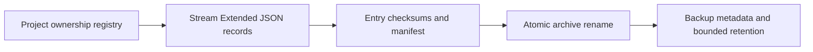

# RC9 Operational Hardening Architecture

RC9 adds an operational safety layer around the frozen RC8 product. It does not
add a narrative authority, agent, graph, writing pipeline, or Paragraph Editor
capability.

| Concern | Existing authority retained | RC9 boundary |
|---|---|---|
| Project data | MongoDB and project ownership registry | Versioned archive/restore adapter |
| Prose safety | Scene lineage and Paragraph Engine | Backup includes lineage; editor unchanged |
| Narrative knowledge | Narrative Analysis Engine and Story Bible | Included or rebuildable after restore |
| AI execution | Provider gateway/settings service | Readiness, privacy, and credential-safe checks |
| Startup | FastAPI lifespan and additive migrations | One supported launcher and migration lease |
| Failures | Existing operation-failure store | Correlation reference on every API response |

## Backup flow

## Restore flow

Persistence is batch-oriented and rollback targets are exact restored project
identities. The source project is never deleted or overwritten.

## Startup and migration

The supported Docker composition waits for MongoDB health before FastAPI and for
API readiness before the frontend. FastAPI obtains a database migration lease,
records each migration outcome, applies additive indexes/metadata, resumes
recoverable Narrative Analysis jobs, then advertises readiness. Shutdown uses
normal container termination and FastAPI lifespan cleanup; volumes persist.

## Privacy boundary

Project backups exclude global settings and credentials. Support bundles use
allowlisted projections and recursive sanitization, and explicitly report their
content policy. Every request receives a correlation reference, but ordinary
responses and logs do not contain provider credentials or raw provider bodies.

## Compatibility

All RC9 endpoints are additive. Project metadata fields are optional for legacy
responses and normalized during idempotent migration. RC8 author-control,
chronology, idempotency, ordering, reference reconciliation, semantic finding,
and publication-blocker contracts remain unchanged.

